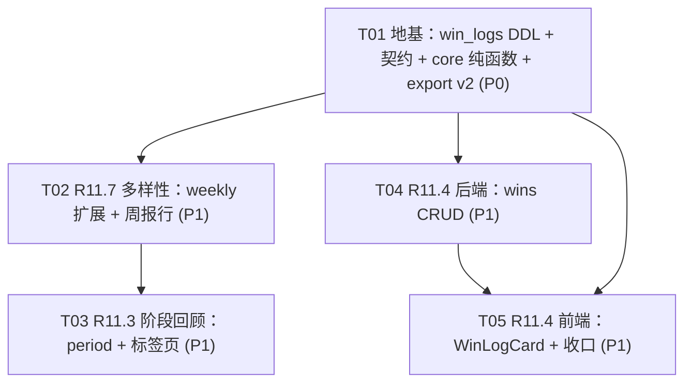

# 「轻生活」增量架构设计 —— 三个全新项（R11.3 / R11.4 / R11.7）

| 项目信息 | 内容 |
| --- | --- |
| 文档语言 | 简体中文 |
| 文档类型 | **增量架构设计 + 任务分解（面向工程师逐条执行）** |
| 上游需求 | `docs/PRD-增量-R11x-未完成功能本轮.md` §4.2（R11.3）/ §4.3（R11.4）/ §4.6（R11.7） |
| 上游架构 | `docs/ARCHITECTURE.md` v1.0（K1~K11）+ `docs/ARCHITECTURE-增量-补完三项.md`（K12~K20，风格与约定保持一致） |
| 作者 | 高见远（架构师） |
| 版本 | v1.0 |
| 范围 | **R11.3 阶段回顾（P1）/ R11.4 非体重胜利（P1，唯一 DDL）/ R11.7 饮食多样性（P1）** |
| 前置 | 补完三项（R3.8/R11.5/R11.6）已实现、QA 通过并上线（eb3a548 / 53c0be7 / 6e2bb4d） |

> **本轮边界**
> - 与上一轮相反：**本轮允许 DDL** —— `win_logs` 是全项目唯一新表，`prisma db push` 是显式任务步骤。
> - **不做**：R3.8 / R11.5 / R11.6（已交付）；N9 围度 / R1.2 微信登录 / 生理周期 / 离群值检测 / 静默自动备份（明确 Out）。
> - `distinctFoodKeys` / `rankFrequentFoods` **已存在**（`packages/core/src/food/identity.ts`，R11.5 时建），本轮**复用不重写**。
> - 只写设计；业务代码由工程师按 §7 任务列表执行。

---

## 0. 一页速览

| 需求 | 落点 | 关键事实 |
| --- | --- | --- |
| **R11.7** | `report.service.weekly()` 扩展 + `WeeklyDiversityRow.tsx`（新） | **零新表、零新接口**。纯向后兼容扩展 `GET /report/weekly`；口径直接复用 `distinctFoodKeys` |
| **R11.3** | `core/report/period.ts`（新）+ `report.controller @Get('period')` + `/report` 标签页框架 | 指标**白名单制**（AC-11.3.2，出现白名单外指标即不通过）+ 禁 `role="meter"` + 禁 `X/Y` 分数式 |
| **R11.4** | `WinLog` Prisma model（唯一 DDL）+ `/api/wins` CRUD + `WinLogCard.tsx` + export v2 | `loggedDate` **服务端生成、只能记今天**（QR-5）；**刻意不加** `(userId, loggedDate)` 唯一约束 |

**三个已经就位、本轮直接吃的红利**（上一轮预留）：

| 已有 | 本轮怎么用 |
| --- | --- |
| `distinctFoodKeys` + `displayFoodName`（core，K16 单一口径） | R11.3 的「食物种类数」与 R11.7 的「N 种不同的食物」**调用同一个函数**（AC-11.7.2 硬约束） |
| `GET /foods/top?days=&limit=` 已支持 `days: 1..365` | R11.3 回顾页的常吃 Top5 **直接复用**，`PeriodReport` 不需要加 topFoods 字段 |
| `RecordOverviewKey` 已含 `'wins'`、`OVERVIEW_KEY_LABELS.wins` 已有文案、`DataOverviewCard` 按 `count > 0` 过滤 | R11.4 上线后 `/data/overview` 的 `wins` 行**真实计数**，前端**零改动**自动显示 |

---

## 1. 整体方案与分层改动说明

```
packages/core         summarizePeriod / resolvePeriodWindow（R11.3 聚合口径）
                      normalizeWinText / checkWinText（R11.4 文本清洗）
                      readExportWins（v1→v2 导出兼容读法）
                      （distinctFoodKeys 复用，不改）
packages/shared-types WinLog 实体 · PeriodReport · wins CRUD 契约 · WeeklyReport 收敛 · ExportJsonPayload.wins
apps/api              WinLog model（唯一 DDL）· /api/wins CRUD · GET /report/period
                      · GET /report/weekly 扩展 · /data/export v2 · /data/overview wins 真实计数
apps/web              /report 标签页（本周 | 这段时间）· 周报多样性行 · /weight 底部 WinLogCard
```

### 1.1 关键设计决策（含对 PM 方案的偏离说明）

| # | 决策 | 说明 |
| --- | --- | --- |
| **D-1** | **R11.3 的聚合 = SQL 下推 + core 归并，两段式** | AC-11.3.8 要求 365 天档 P95 < 500ms 且禁止把原始记录拉进内存。但 `distinctFoodCount` 需要**食物名**，而 `meal_logs` 不存名字（只有 `foodItemId`/`customName`）。方案：`groupBy([foodItemId, customName, loggedDate])` 得到最小投影 → 一次 `in` 查询反查名字 → 交给 core。这与已上线的 `foods.top()` 是**同一套已验证的模式**（`foods.service.ts:191-243`），直接照抄结构 |
| **D-2** | `WeeklyReport` / `ReportDay` / `MicronutrientSummary` **收敛到 `shared-types`** | 现状：`report.service.ts:37` 与 `ReportPage.tsx:36` 各有一份（QA BUG-01 同款漂移风险）。本轮要扩展它，先收敛再扩展，一次到位 |
| **D-3** | 周报多样性行**不新增接口**，`GET /report/weekly` 加三个字段 | PM 契约给了 `distinctFoodCount` + `distinctFoods`；**额外加 `distinctFoodsTruncated: boolean`**（偏离说明：AC-11.7.4 要求超 200 条时展示「已经很多啦，先显示这些」，UI 必须知道是否被截断，否则无法渲染这句话）。加字段是向后兼容的，老客户端忽略即可 |
| **D-4** | 回顾页常吃 Top5 **复用 `GET /foods/top`**，不进 `PeriodReport` | `days` 参数已支持 1..365（`foods.service.ts:196` 校验）。`PeriodReport` 保持 PM 定义的白名单 6 类指标，不多不少 —— 加字段反而增加「白名单外指标」的误判面 |
| **D-5** | `wins` 列表返回裸数组 `WinLog[]`，按 `createdAt` ASC | 与既有 `/foods/recent` → `FoodItem[]` 风格一致。⚠️ 但实现必须 **`orderBy desc + take 200 + reverse`**：ASC + take 200 会取到**最老的** 200 条，历史一长新记录永远看不到 —— 这是最容易写反的一处 |
| **D-6** | `GET /data/overview` 的 `wins` 行从「恒 0」改为真实 `winLog.aggregate` | 类型、文案、前端过滤逻辑全部已就位（上一轮 Q-6 的预留），**后端一行聚合 + 前端零改动** |
| **D-7** | 导出 `schemaVersion` 1 → 2；兼容读法 `readExportWins()` 放 **core** | v1 数据 `wins` 视为空数组不报错（QR-6）。放 core 而非 shared-types：shared-types 是「纯类型包、不含可执行逻辑」，且 core 不许 import shared-types（K12），用结构性类型定义返回形状即可 |
| **D-8** | `/report` 标签页把现有周报 JSX **原样搬进** `WeeklyReportView.tsx` | `report-trends.test.tsx` 直接渲染 `ReportPage` 并断言周报内容。拆出组件时**一行逻辑不改**（只挪位置 + 类型改从 shared-types 导入），保证回归基线不破 |

---

## 2. 完整文件清单

> 图例：**[新]** 新建 · **[改]** 修改 · **[冻]** 冻结（回归保护，只能读不许重构/删除）

### 2.1 `packages/core`（新增 6 / 修改 1）

| 路径 | 职责 | 状态 |
| --- | --- | --- |
| `packages/core/src/report/period.ts` | `resolvePeriodWindow` / `summarizePeriod` —— 阶段回顾聚合口径（零 IO） | **[新]** |
| `packages/core/src/win/text.ts` | `WIN_TEXT_MAX_LENGTH` / `normalizeWinText` / `winTextLength` / `checkWinText` | **[新]** |
| `packages/core/src/export/payload.ts` | `readExportWins` —— 导出 JSON 的 `wins` 键 v1→v2 兼容读法 | **[新]** |
| `packages/core/src/index.ts` | 追加上述导出（追加到文件末尾，不动既有导出） | **[改]** |
| `packages/core/test/report-period.test.ts` | 回顾聚合单测（含 AC-11.3.7 全部边界） | **[新]** |
| `packages/core/test/win-text.test.ts` | 文本清洗单测（AC-11.4.9） | **[新]** |
| `packages/core/test/export-payload.test.ts` | v1/v2 兼容读法单测（QR-6） | **[新]** |

### 2.2 `packages/shared-types`（修改 3）

| 路径 | 职责 | 状态 |
| --- | --- | --- |
| `packages/shared-types/src/entities.ts` | 新增 `WinLog` 实体（L603 之后追加第 21 号实体段） | **[改]** |
| `packages/shared-types/src/api.ts` | 新增 wins CRUD 契约 + `PeriodReport`；**`WeeklyReport`/`ReportDay`/`MicronutrientSummary` 从 `report.service.ts` 收敛进来**（D-2） | **[改]** |
| `packages/shared-types/src/export.ts` | 新增 `ExportWinRow`；`ExportJsonPayload` 加 `wins`；`EXPORT_SCHEMA_VERSION` 1 → **2** | **[改]** |

### 2.3 `apps/api`（新增 6 / 修改 8）

| 路径 | 职责 | 状态 |
| --- | --- | --- |
| `apps/api/prisma/schema.prisma` | 新增 `WinLog` model（第 22 号）+ `User.wins WinLog[]` 反向关系 | **[改]** |
| `apps/api/prisma/schema.pg.prisma` | 同步同一 model（PG 方言：BigInt 主键 / `@db.Date` / `@db.Timestamptz(6)`，照抄相邻 `WaterLog` 的转换规则） | **[改]** |
| `docs/SCHEMA.sql` | 追加 `win_logs` SQLite DDL（两套 DDL 是权威文档，必须与 schema 同步） | **[改]** |
| `docs/schema.pg.sql` | 追加 `win_logs` PG DDL | **[改]** |
| `apps/api/src/wins/wins.module.ts` | WinsModule | **[新]** |
| `apps/api/src/wins/wins.controller.ts` | `GET/POST /wins`、`DELETE /wins/:id` | **[新]** |
| `apps/api/src/wins/wins.service.ts` | 列表 / 创建 / 删除（见 §5.2） | **[新]** |
| `apps/api/src/wins/dto/create-win.dto.ts` | `POST /api/wins` 请求体校验 | **[新]** |
| `apps/api/src/report/dto/period-report.dto.ts` | `GET /report/period` 查询参数校验（`days` 仅接受 30/365） | **[新]** |
| `apps/api/test/r11-new.e2e.test.ts` | 三个新接口 + 越权 + 兼容性 e2e | **[新]** |
| `apps/api/src/app.module.ts` | 注册 `WinsModule` | **[改]** |
| `apps/api/src/common/constants/error-codes.ts` | 新增 `NOTFOUND_WIN: 'E_NOTFOUND_WIN'`（与 `NOTFOUND_MEAL` 等并列） | **[改]** |
| `apps/api/src/report/report.service.ts` | ① `weekly()` 增加 `distinctFoodCount` / `distinctFoods` / `distinctFoodsTruncated`（复用 `distinctFoodKeys`）；② 新增 `period()`；③ **删除本地 `WeeklyReport` 定义改从 shared-types 导入** | **[改]** |
| `apps/api/src/report/report.controller.ts` | 新增 `@Get('period')`（静态路径，声明在 `weekly` 旁边即可，无参数路由冲突） | **[改]** |
| `apps/api/src/data/data.service.ts` | ① `exportAll()` 增加 `wins` 查询与映射；② `overview()` 的 `wins` 行改为真实 `winLog.aggregate` | **[改]** |

### 2.4 `apps/web`（新增 9 / 修改 6）

| 路径 | 职责 | 状态 |
| --- | --- | --- |
| `apps/web/src/pages/report/ReportTabs.tsx` | `/report` 标签页外壳（本周 \| 这段时间），**默认选中「本周」**（AC-11.3.1，避免回归） | **[新]** |
| `apps/web/src/pages/report/WeeklyReportView.tsx` | 现有周报 JSX **原样迁入**（D-8，一行逻辑不改），并挂载多样性行 | **[新]** |
| `apps/web/src/pages/report/WeeklyDiversityRow.tsx` | R11.7：一行「这周吃到了 N 种不同的食物」+ 可展开清单 | **[新]** |
| `apps/web/src/pages/report/PeriodReportView.tsx` | R11.3：30/365 切换 + 白名单六项 + 整屏空态 + 常吃 Top5（复用 `/foods/top`） | **[新]** |
| `apps/web/src/pages/weight/WinLogCard.tsx` | R11.4：输入框 + 时间线列表 + 「删掉这条」 | **[新]** |
| `apps/web/test/report-period.test.tsx` | R11.3 组件测试（白名单 / 空态 / 禁 meter） | **[新]** |
| `apps/web/test/weekly-diversity.test.tsx` | R11.7 组件测试（展开 / 空值整行隐藏 / 截断提示） | **[新]** |
| `apps/web/test/win-log-card.test.tsx` | R11.4 组件测试（离线 / 删除 / 无必填校验） | **[新]** |
| `apps/web/test/export-wins-compat.test.ts` | v1 备份数据读 `wins` 不报错 | **[新]** |
| `apps/web/src/pages/report/ReportPage.tsx` | 收缩为标签页外壳；本地 `WeeklyReport` 接口删除改从 shared-types 导入 | **[改]** |
| `apps/web/src/pages/weight/WeightPage.tsx` | 在 `</section>`（L467）之前、`近期记录` 卡之后挂载 `<WinLogCard />` | **[改]** |
| `apps/web/src/lib/copy.ts` | 新增回顾 / 多样性 / wins 文案（**只增不改**，既有 `dataBackup*` 一律不动） | **[改]** |
| `apps/web/src/lib/queryClient.ts` | `queryKeys` 追加 `periodReport(days, endDate)`、`wins(days)` | **[改]** |
| `apps/web/src/lib/csv.ts` | `createEmptyExportPayload()` 补 `wins: []`（加字段后此处是唯一的编译报错点） | **[改]** |
| `apps/web/src/pages/why-numbers/WhyNumbersPage.tsx` | 追加 ⑬⑭⑮ 三节（见 §6，插入点 L826 `<nav>` 之前） | **[改]** |

### 2.5 冻结文件（回归保护）

| 路径 | 为什么冻结 |
| --- | --- |
| `apps/web/src/pages/settings-data/DataOverviewCard.tsx` | `count > 0` 过滤逻辑已就位，`wins` 行真实计数后**自动出现**。任何"顺手改一下"都是多余 diff |
| `apps/web/src/lib/copy.ts` 的 `OVERVIEW_KEY_LABELS`（L488-495，`wins: '体重之外的变化'` 已存在） | 文案已符合红线，本轮零改动 |
| `apps/web/src/lib/backup.ts` + `copy.ts` 的 `dataBackup*` 常量 + `data-testid="last-backup"` | R11.6 交付物，本轮不碰 |
| `packages/core/src/food/identity.ts` + `food/frequency.ts` | **唯一口径实现**（K16），R11.3/R11.7 只消费不修改 |
| `apps/web/src/pages/diary/*`（`usePointerReorder` / `MealItemRow` / `MealComposer` / `DiaryPage`） | R3.8/R11.5 交付物，本轮需求与 `/diary` 无交集 |
| `apps/api/src/foods/foods.service.ts` 的 `top()` | R11.3 直接调用它的接口，**不改它本身** |

### 2.6 汇总

| 分类 | 新增 | 修改 | 冻结 | 合计（变更） |
| --- | --- | --- | --- | --- |
| `packages/core` | 6 | 1 | 2 | 7 |
| `packages/shared-types` | 0 | 3 | — | 3 |
| `apps/api` | 6 | 8 | 1 | 14 |
| `apps/web` | 9 | 6 | 5 | 15 |
| **合计** | **21** | **18** | **8** | **39** |

---

## 3. 数据库变更（本轮唯一 DDL）

### 3.1 `WinLog` model（SQLite 主 schema，追加在 `AiTrace` 之后）

```prisma
// -----------------------------------------------------------------------------
// 22. win_logs —— 体重之外的变化（R11.4，四期）
// -----------------------------------------------------------------------------
// ⚠️ 刻意**不加** (userId, loggedDate) 唯一约束：同一天允许多条 ——
//    这是「随手记」而不是「每日打卡」，加唯一约束会把它变成一天只能完成一次的任务，
//    直接违反约束 3（反游戏化）。PM §4.3 已拍板，不得"顺手补上"。
// ⚠️ `text` 长度由应用层校验（≤60 字，checkWinText），DB 不约束 ——
//    超限返回 400 且**不静默截断**（AC-11.4.2），避免「我写的和我存的不一样」。
model WinLog {
  id         Int    @id @default(autoincrement())
  userId     Int    @map("user_id")
  loggedDate String @map("logged_date") // 'YYYY-MM-DD' 本地日粒度
  text       String // 正文 ≤ 60 字（应用层校验）
  createdAt  String @default(dbgenerated("(strftime('%Y-%m-%dT%H:%M:%fZ','now'))")) @map("created_at")
  updatedAt  String @default(dbgenerated("(strftime('%Y-%m-%dT%H:%M:%fZ','now'))")) @map("updated_at")

  user User @relation(fields: [userId], references: [id], onDelete: Cascade)

  @@index([userId, loggedDate], map: "ix_win_user_date")
  @@map("win_logs")
}
```

`User` model 同步追加反向关系（与其他业务表写法一致）：

```prisma
  wins WinLog[]
```

### 3.2 PG 快照（`schema.pg.prisma`）

同一 model 按 PG 方言转换，**照抄相邻 `WaterLog` 的既有规则**（不要自创）：

| SQLite 写法 | PG 写法 |
| --- | --- |
| `id Int @id @default(autoincrement())` | `id BigInt @id @default(autoincrement())` |
| `loggedDate String @map("logged_date")` | `loggedDate DateTime @map("logged_date") @db.Date` |
| `createdAt/updatedAt String @default(dbgenerated("(strftime(...)"))` | `@default(now()) @db.Timestamptz(6)` |
| 索引 / `@@map` | 完全一致 |

### 3.3 两套 DDL 文档同步

`docs/SCHEMA.sql`（SQLite）与 `docs/schema.pg.sql`（PG）是权威 DDL 文档，必须与 schema **同一次提交**内追加 `win_logs`：

```sql
-- SQLite（docs/SCHEMA.sql 追加）
CREATE TABLE win_logs (
  id          INTEGER PRIMARY KEY AUTOINCREMENT,
  user_id     INTEGER NOT NULL REFERENCES users(id) ON DELETE CASCADE,
  logged_date TEXT    NOT NULL,             -- 'YYYY-MM-DD' 本地日粒度
  text        TEXT    NOT NULL,             -- ≤ 60 字（应用层校验）
  created_at  TEXT    NOT NULL DEFAULT (strftime('%Y-%m-%dT%H:%M:%fZ','now')),
  updated_at  TEXT    NOT NULL DEFAULT (strftime('%Y-%m-%dT%H:%M:%fZ','now'))
);
CREATE INDEX ix_win_user_date ON win_logs(user_id, logged_date);
```

### 3.4 迁移 / 推送顺序（工程师照做，顺序不可调换）

| 步骤 | 命令 / 动作 | 说明 |
| --- | --- | --- |
| ① | 一次性修改 4 份文件：`schema.prisma` + `schema.pg.prisma` + `docs/SCHEMA.sql` + `docs/schema.pg.sql` | 四份必须同一提交，两套 schema 漂移会导致生产构建期报错（历史 P0 缺陷） |
| ② | `cd apps/api && npx prisma db push` | 项目**无** `prisma/migrations/` 目录（现状即 `db push` 工作流）；此命令同时重建 SQLite client |
| ③ | **不要**在本地执行 `prisma generate --schema schema.pg.prisma` | 会把 client 覆盖成 PG 类型，本地起不来。PG client 只在生产构建管线生成（`schema.pg.prisma` 头部注释已有说明） |
| ④ | `npm test` 全量回归 | `db push` 只增表不改既有表，159+ 既有用例必须全绿 —— 这是 DDL 步骤的通过判据 |
| ⑤ | e2e 里对 `win_logs` 的断言使用**动态**建数据，不依赖 seed | 种子不含 win 数据；`GET /data/overview` 的 `wins: 0` 空态用例反而要保留 |

---

## 4. `packages/shared-types` 契约增量

> 响应一律走统一信封（K2）。下文只描述 `data` 的形状。

### 4.1 新增实体（`entities.ts` 追加）

```ts
/** 表 `win_logs` —— 体重之外的变化（R11.4）。⚠️ 刻意无 (userId, loggedDate) 唯一约束。 */
export interface WinLog {
  id: number;
  /** db: user_id */
  userId: number;
  /** db: logged_date —— `YYYY-MM-DD` 本地日粒度；**服务端生成，只能记今天**（QR-5） */
  loggedDate: string;
  /** db: text —— ≤60 字（应用层校验） */
  text: string;
  /** db: created_at —— ISO8601 UTC */
  createdAt: string;
  /** db: updated_at */
  updatedAt: string;
}
```

### 4.2 R11.4 契约（`api.ts` 追加）

```ts
/** `POST /api/wins` 请求。⚠️ 不含 loggedDate：由服务端按本地今天生成（QR-5，不支持补录）。 */
export interface CreateWinRequest {
  /** 正文，≤60 字（超限 400，不静默截断） */
  text: string;
}

/** `GET /api/wins` 查询参数。 */
export interface ListWinsQuery {
  /** 往前追溯的天数（含今天），默认 90 */
  days?: number;
}

/** `DELETE /api/wins/:id` 响应。 */
export interface DeleteWinResponse {
  deleted: true;
}
```

### 4.3 R11.3 契约（`api.ts` 追加）

```ts
/** 阶段回顾允许的档位（QR-3：只 30/365 两档，不做 90 天档）。 */
export type PeriodDays = 30 | 365;

/** 记到最多的习惯（白名单指标 ④，最多 2 个）。 */
export interface PeriodTopHabit {
  habitId: number;
  name: string;
  count: number;
}

/**
 * `GET /api/report/period` 响应 —— 指标**白名单制**（AC-11.3.2）：
 * 只允许出现下列 6 类，出现白名单外指标即判定不通过。
 */
export interface PeriodReport {
  from: string;
  to: string;
  days: PeriodDays;
  /** 供整屏空态判断（区间内零记录 → 前端不渲染任何指标卡） */
  hasAnyData: boolean;
  /** ① 有记录的天数（任一表当日有行即计数） */
  loggedDays: number;
  /** ② 不同食物种类数（与 R11.7 共用 `distinctFoodKeys`，K16） */
  distinctFoodCount: number;
  /** ③ 餐次条目总数（`meal_logs` 行数口径） */
  mealEntryCount: number;
  /** ④ 记到最多的习惯（最多 2 个；并列时按 habitId 升序截断） */
  topHabits: PeriodTopHabit[];
  /** ⑤ 运动次数与总时长 */
  exercise: { sessions: number; totalMinutes: number };
  /**
   * ⑥ 体重变化量 —— **取有记录的首末条**，而非日历首末日；
   * 任一端缺失（含区间内仅 1 条）为 `null`，前端**整块隐藏**（不显示 0、不显示「—」）。
   */
  weight: { startKg: number; endKg: number; deltaKg: number } | null;
  /** 「体重之外的变化」条数（R11.4 上线前恒 0；唯一允许的计数出口，AC-11.4.6） */
  winCount: number;
}
```

### 4.4 R11.7 契约（`WeeklyReport` 收敛 + 扩展）

```ts
/** 单日汇总（原 `report.service.ts` 本地定义，收敛到契约层，D-2）。 */
export interface ReportDay { date: string; intakeKcal: number; exerciseKcal: number; waterMl: number; habitsDone: number; habitsTotal: number; }

/** 微量营养素行（原内联匿名类型收敛）。 */
export interface MicronutrientSummary { key: string; name: string; unit: string; dailyAvg: number; reference: number; direction: string; }

/** 周报（R4.1 / R11.1 / **R11.7 扩展**）。 */
export interface WeeklyReport {
  from: string;
  to: string;
  days: ReportDay[];
  avgIntakeKcal: number;
  totalExerciseKcal: number;
  weightChangeKg: number | null;
  micronutrients: MicronutrientSummary[];
  referenceNote: string;
  // ---- R11.7 向后兼容扩展（新增三个字段，老客户端忽略未知字段即可，AC-11.7.6）----
  /** 不同食物种类数（与 R11.3 共用 `distinctFoodKeys` 口径，K16） */
  distinctFoodCount: number;
  /** 食物名称清单（≤200，按首次出现顺序 = 最早出现日期序） */
  distinctFoods: string[];
  /** 清单是否被 200 上限截断（UI 据此展示「已经很多啦，先显示这些」） */
  distinctFoodsTruncated: boolean;
}
```

> ⚠️ `report.service.ts` 与 `ReportPage.tsx` 的本地 `WeeklyReport` 定义**删除**，改从 `@qsh/shared-types` 导入。这是防漂移（QA BUG-01 同款问题），且是本轮扩展该类型的必经之路。

### 4.5 导出契约（`export.ts` 修改）

```ts
/** `wins[]` 元素（来源 `win_logs`）。语义是用户自由文本，与其他业务实体无外键，导出时不联表。 */
export interface ExportWinRow {
  /** `YYYY-MM-DD` */
  date: string;
  text: string;
}

export interface ExportJsonPayload {
  meta: ExportMeta;
  profile: ExportProfile;
  goals: ExportGoals;
  weights: ExportWeightRow[];
  meals: ExportMealRow[];
  exercises: ExportExerciseRow[];
  habits: ExportHabitRow[];
  water: ExportWaterRow[];
  /** R11.4 新增顶层键（schemaVersion 2） */
  wins: ExportWinRow[];
  settings: ExportSettings;
}

/** 当前导出结构版本（1 → 2：新增 `wins` 顶层键，QR-6） */
export const EXPORT_SCHEMA_VERSION = 2;
```

> 加**必填**字段（而非可选）是有意的：`data.service.ts` 与 web 的 `createEmptyExportPayload()` 必须在同一次提交里补上，编译器强制两端同步，不留半成品。

---

## 5. `packages/core` 纯函数签名

### 5.1 `packages/core/src/report/period.ts`

```ts
export const PERIOD_DAY_OPTIONS = [30, 365] as const;
export type PeriodDaysOption = (typeof PERIOD_DAY_OPTIONS)[number];
/** 白名单指标 ④ 的展示上限（PM：并列时最多展示 2 个）。 */
export const PERIOD_TOP_HABITS = 2;

/**
 * 解析回顾区间（纯函数，`todayKey` 由参数注入 —— K8 禁 Date.now()）。
 * - `days` 不在 {30, 365} → `null`（API 层转 400；不允许隐式默认，避免口径猜测）；
 * - `endDateKey` 缺失 / 晚于今天 → 裁剪到今天（AC-11.3.7「区间含未来日期」边界）。
 */
export function resolvePeriodWindow(
  days: number,
  endDateKey: string | null,
  todayKey: string,
): { from: string; to: string } | null;

/** SQL 下推后的**聚合事实**（不是原始行 —— AC-11.3.8）。 */
export interface PeriodFacts {
  /** 各表 `groupBy(loggedDate)` 日期键的并集（≤365 项，来自 SQL，不是原始行） */
  loggedDates: readonly string[];
  /** 食物身份投影（groupBy 三元组 + 名称反查，与 foods.top 同构） */
  foodRows: readonly FoodRefRow[];
  /** `meal_logs` 行数（SQL count） */
  mealEntryCount: number;
  /** 习惯聚合（`groupBy(habitId)` + 名称反查，仅 done=true） */
  habitCounts: ReadonlyArray<{ habitId: number; name: string; count: number }>;
  /** 运动聚合（SQL groupBy(loggedDate) 的 _count/_sum 求和） */
  exercise: { sessions: number; totalMinutes: number };
  /** 体重首条（find asc）——带 id 用于判重；区间无记录为 null */
  weightFirst: { id: number; date: string; weightKg: number } | null;
  /** 体重末条（find desc）；区间无记录为 null */
  weightLast: { id: number; date: string; weightKg: number } | null;
  /** 非体重胜利条数（winLog groupBy 的 count 和） */
  winCount: number;
}

export interface PeriodSummary {
  from: string;
  to: string;
  hasAnyData: boolean;
  loggedDays: number;
  distinctFoodCount: number;
  mealEntryCount: number;
  topHabits: Array<{ habitId: number; name: string; count: number }>; // ≤ PERIOD_TOP_HABITS
  exercise: { sessions: number; totalMinutes: number };
  /** 任一端缺失 / 首末是同一条记录 → null（整块隐藏，不显示 0） */
  weight: { startKg: number; endKg: number; deltaKg: number } | null;
  winCount: number;
}

/** 归并聚合事实为回顾摘要（纯计算；`distinctFoodCount` 内部调用 `distinctFoodKeys`）。 */
export function summarizePeriod(facts: PeriodFacts, options: { from: string; to: string }): PeriodSummary;
```

**内部口径（写进 `/why-numbers` ⑬，也是单测断言依据）**

| 指标 | 口径 |
| --- | --- |
| `loggedDays` | `loggedDates` 中落在 `[from, to]` 内的去重天数（**含未来日期则裁掉** —— AC-11.3.7 边界）。什么算"有记录"：当日 weight/meal/exercise/habit/water/win 任一有行 |
| `distinctFoodCount` | `distinctFoodKeys(foodRows, { limit: Infinity }).count`（只要计数，不要清单） |
| `topHabits` | `habitCounts` 按 `count desc → habitId asc` 排序取前 2（并列时确定可复现） |
| `weight` | `weightFirst !== null && weightLast !== null && weightFirst.id !== weightLast.id` 才产出；`deltaKg = round2(end − start)`；**只有 1 条记录 → null**（AC-11.3.7 边界） |
| `hasAnyData` | `loggedDays > 0` |

**单测必须覆盖的边界**（`report-period.test.ts`，对应 AC-11.3.7）

| 用例 | 期望 |
| --- | --- |
| 空区间（全部事实为空） | `hasAnyData=false`、`loggedDays=0`、`weight=null`、`topHabits=[]` |
| 单日 | `loggedDays=1`；体重仅一条 → `weight=null`（**不是 0**） |
| 跨 365 天 | 全部指标正常聚合 |
| 习惯并列第一（3 个同为 41 次） | 只出 2 个，且按 `habitId` 升序截断 |
| `loggedDates` 含未来日期 | 被裁剪，不计入 `loggedDays` |
| 体重首末为同一条（id 相同） | `weight=null`（整块隐藏） |
| 体重下降 / 上涨 | `deltaKg` 为负 / 正，保留 2 位小数，**core 不产出任何评价语句** |
| `distinctFoodCount` 与 `distinctFoodKeys` 同源 | 同一组投影行，两处调用结果一致（K16 防漂移断言） |

### 5.2 `packages/core/src/win/text.ts`

```ts
/** 正文长度上限（AC-11.4.2）。按 Unicode 码点计数（中文 1 字 = 1 码点）。 */
export const WIN_TEXT_MAX_LENGTH = 60;

/**
 * 清洗：trim + 折叠空白（**换行折叠为单个空格**，AC-11.4.9）。
 * 空串 / 非字符串输入返回 ''。
 */
export function normalizeWinText(text: string): string;

/** 码点计数（`Array.from(text).length`；emoji 等代理对算 1 个）。 */
export function winTextLength(text: string): number;

export type WinTextCheck =
  | { ok: true; text: string }
  | { ok: false; reason: 'empty' | 'tooLong'; length: number };

/**
 * 校验 + 清洗一步完成：
 * - 清洗后为空 → `{ ok:false, reason:'empty' }`（前端**静默忽略不提交**；服务端转 400）；
 * - 长度 > 60 → `{ ok:false, reason:'tooLong', length }`（**不截断** —— 后端返回 400 且不入库）；
 * - 否则 `{ ok:true, text }`（清洗后的文本，入库用它）。
 */
export function checkWinText(text: string, maxLength?: number): WinTextCheck;
```

**单测必须覆盖的边界**（`win-text.test.ts`，对应 AC-11.4.9）

| 用例 | 期望 |
| --- | --- |
| 纯空格 / 空串 / 换行 | `{ ok:false, reason:'empty' }` |
| 首尾空白 | trim |
| 含换行 | 折叠为单空格 |
| 恰好 60 个中文字 | `{ ok:true }` |
| 61 个中文字 | `{ ok:false, reason:'tooLong', length:61 }`（**不截断**） |
| emoji / 代理对 | 按 1 个码点计数 |
| 全角空格 | 视为空白，被 trim / 折叠 |

### 5.3 `packages/core/src/export/payload.ts`

```ts
/** `wins` 顶层键自 schemaVersion 2 起存在。 */
export const EXPORT_SCHEMA_VERSION_MIN_WINS = 2;

export interface ExportWinRowLike {
  date: string;
  text: string;
}

/**
 * 读取导出 JSON 的 `wins` 顶层键（QR-6）：
 * - v1（无该键）/ `raw` 非对象 / `wins` 非数组 / 元素缺字段 → **一律返回 []，绝不抛错**；
 * - 元素 `date` / `text` 非字符串的**逐条过滤**，不因单条脏数据丢整批。
 */
export function readExportWins(raw: unknown): ExportWinRowLike[];
```

**单测边界**（`export-payload.test.ts`）：v1 payload（无 wins 键）→ `[]`；v2 → 逐条返回；`wins: null` / `wins: 'x'` → `[]`；元素缺 `text` → 该条被过滤；`raw = null` / `raw = 'str'` → `[]`。

### 5.4 复用声明（不重写）

| 函数 | 位置 | 本轮消费方 |
| --- | --- | --- |
| `distinctFoodKeys` / `foodIdentity` / `displayFoodName` / `normalizeFoodName` | `core/src/food/identity.ts`（**[冻]**） | R11.3 `summarizePeriod` 内部、R11.7 `weekly()` 扩展 |
| `round2` | `core/src/calorie/rounding.ts` | `summarizePeriod` 的 `deltaKg` |
| `toLocalDateKey` | `core/src/date/daykey.ts` | 日期键处理 |

---

## 6. API 签名清单

> 全部走 `JwtAuthGuard`；`userId` 一律从 JWT 取（K7），忽略请求体任何 userId；统一信封（K2）。

### 6.1 `POST /api/wins`（新增 · R11.4）

| 项 | 内容 |
| --- | --- |
| **鉴权** | `JwtAuthGuard` |
| **请求体** | `{ text: string }` —— **没有 `loggedDate` 字段**，服务端按本地今天生成（QR-5，不支持补录；DTO 层也不接受该字段，传了即 `class-validator` 报 `forbidden property` 或被忽略） |
| **响应 200** | `{ data: WinLog, error: null }` |
| **响应 400** | `checkWinText` 失败：`reason==='empty'` → `E_VALID_INPUT`（message「想写点什么再记下来也行」）；`reason==='tooLong'` → `E_VALID_INPUT` + `fields.text: "最多能写 60 个字"`，**不入库、不截断** |
| **入库文本** | `checkWinText(text).text`（清洗后），`loggedDate = todayLocalKey()` |

### 6.2 `GET /api/wins`（新增 · R11.4）

| 项 | 内容 |
| --- | --- |
| **鉴权** | `JwtAuthGuard` |
| **查询参数** | `?days=90`（默认 90；允许 1–365，越界 400 `E_VALID_INPUT`） |
| **响应 200** | `{ data: WinLog[], error: null }` —— 裸数组（与 `/foods/recent` 风格一致），上限 **200 条**，按 `createdAt` **ASC**（AC-11.4.3） |
| **实现要点** | 先 `orderBy createdAt desc + take 200` 取**最新** 200 条，再 reverse 成 ASC 返回（D-5 —— 直接 ASC + take 会拿到最老的 200 条，写反了新记录永远看不到） |

### 6.3 `DELETE /api/wins/:id`（新增 · R11.4）

| 项 | 内容 |
| --- | --- |
| **鉴权** | `JwtAuthGuard` |
| **响应 200** | `{ data: { deleted: true }, error: null }` |
| **响应 404** | 他人资源或不存在 → `E_NOTFOUND_WIN`「没有找到这一条」（不泄露存在性，K7） |
| **无二次确认** | 删除是低风险操作，前端不做确认弹窗（AC-11.4.4） |

### 6.4 `GET /api/report/period`（新增 · R11.3）

| 项 | 内容 |
| --- | --- |
| **鉴权** | `JwtAuthGuard` |
| **查询参数** | `?endDate=YYYY-MM-DD&days=30|365`。`days` **缺省 → 400**、非 30/365 → 400（PM 明确：不允许隐式默认）；`endDate` 可选，缺省今天，晚于今天裁剪到今天 |
| **响应 200** | `{ data: PeriodReport, error: null }` |
| **性能门禁** | P95 < **500ms**（365 天档；NFR-3 的 300ms 不适用于本只读聚合，AC-11.3.8 单列） |

**服务端查询编排（全部 SQL 下推，`Promise.all` 并发，无原始行进内存）**

| # | 查询 | 产出 |
| --- | --- | --- |
| 1 | `mealLog.groupBy({ by:['foodItemId','customName','loggedDate'], where:{userId, loggedDate:{gte,lte}}, orderBy:[loggedDate asc, foodItemId asc, customName asc] })` | 食物身份投影 + meal 侧日期并集 |
| 2 | `mealLog.count({ where })` | `mealEntryCount` |
| 3 | `foodItem.findMany({ where:{ id:{ in: ids } }, select:{ id, name } })` | 名称反查（D-6，一次 in，避免 N+1） |
| 4 | `exerciseLog.groupBy({ by:['loggedDate'], _count:{_all:true}, _sum:{minutes:true} })` | sessions/totalMinutes（求和）+ 日期并集 |
| 5 | `habitCheckin.groupBy({ by:['loggedDate'] })` | 日期并集（**含 done=false**：记过就算，与 `/data/overview` 口径一致） |
| 6 | `habitCheckin.groupBy({ by:['habitId'], where:{ done:true }, _count:{_all:true} })` | topHabits 候选 |
| 7 | `habitDefinition.findMany({ where:{ OR:[{userId},{userId:null}] }, select:{ id, name } })` | 习惯名反查 |
| 8 | `weightLog.findFirst({ orderBy: loggedAt asc })` + `findFirst({ orderBy: loggedAt desc })` | 体重首末条（两次轻查询，**不**拉全量） |
| 9 | `waterLog.groupBy({ by:['loggedDate'] })` | 日期并集 |
| 10 | `winLog.groupBy({ by:['loggedDate'], _count:{_all:true} })` | `winCount`（Σcount）+ 日期并集 |

10 个并发查询全部命中既有索引（`ix_*_user_date`），365 天档每个 ≤365 行投影，SQLite 上远低于 500ms。

### 6.5 `GET /api/report/weekly`（**扩展**，非新增 · R11.7）

| 项 | 内容 |
| --- | --- |
| **请求** | 不变（`?endDate=YYYY-MM-DD`） |
| **响应 200** | 既有字段全部保留，**新增** `distinctFoodCount: number` / `distinctFoods: string[]` / `distinctFoodsTruncated: boolean`（D-3） |
| **向后兼容** | 纯加字段，老客户端忽略未知字段即可，无需改版（AC-11.7.6） |
| **实现** | 在 `weekly()` 内追加一次 `mealLog.groupBy`（同 §6.4 第 1 条的 7 天版）+ 名称反查，然后 `distinctFoodKeys(projection, { limit: 200 })`；`truncated = result.truncated` |
| **空值语义** | 本周无任何餐次记录 → `distinctFoodCount: 0`、`distinctFoods: []`；**前端整行隐藏**（AC-11.7.5：不显示「0 种」，0 在这里会被读成一种成绩） |

### 6.6 `GET /api/data/export`（改动 · R11.4）

- `meta.schemaVersion`：`1` → **`2`**；
- 顶层新增 `wins: ExportWinRow[]`（一次 `winLog.findMany({ where:{userId}, orderBy:[{loggedDate:'asc'},{id:'asc'}] })`，映射 `{date: loggedDate, text}`）；
- **读取兼容**：v1 数据无 `wins` 键 → `readExportWins()` 返回 `[]`，不报错（core §5.3）。

### 6.7 `GET /api/data/overview`（改动 · R11.4 联动）

- **唯一改动点**：`data.service.ts:180` 的硬编码 `{ key:'wins', count:0, firstDate:null, lastDate:null }` 替换为真实 `winLog.aggregate({ where:{userId}, _count:{_all:true}, _min:{loggedDate:true}, _max:{loggedDate:true} })`；
- **前端零改动**：`DataOverviewCard` 已按 `count > 0` 过滤（[冻]），`OVERVIEW_KEY_LABELS.wins` 文案已存在；
- R11.4 上线前该行仍为 0 / 隐藏，上线后自动出现 —— 这是上一轮 Q-6 预留位的兑现。

---

## 7. `/why-numbers` 同步位置（NFR-11 硬约束）

**文件**：`apps/web/src/pages/why-numbers/WhyNumbersPage.tsx`（现 842 行，已有 ①~⑫ 节）
**插入点**：第 826 行 `<nav aria-label="相关页面">` **之前**（即 ⑫「备份提醒与记录概览」节之后），依次追加 ⑬⑭⑮ 三节。样式 100% 复用现有 `section + DerivationRow + 收尾免责句` 结构，编号沿用中文数字序列。

| 编号 | 标题 | `aria-labelledby` | 用 `DerivationRow` 讲清楚的条目 | 交付批次 |
| --- | --- | --- | --- | --- |
| **⑬** | 「这段时间」里的六个数字怎么来 | `why-period-title` | · 有记录的天数：当日体重/饮食/运动/习惯/饮水/这句话**任一有记录**即计数；区间含今天<br>· 食物种类数：与周报**同一个函数**（`distinctFoodKeys`），归一化显示名优先<br>· 餐次条目：`meal_logs` 行数<br>· 记到最多的习惯：按 `done=true` 打卡行计数、并列时最多展示 2 个<br>· 运动：次数与 `sum(minutes)`<br>· **体重变化量：取区间内有记录的首条与末条之差，不是日历首末日；只有一条记录时整块不显示**（最易误解，必须写明） | T03 |
| **⑭** | 不同食物的种类是怎么数出来的 | `why-distinct-foods-title` | · 数据源：`meal_logs` 的对应区间<br>· 身份口径：**归一化显示名称优先，缺失回落食物库 id**（「种类」是用户的语言）；库内条目与同名快加条目合并为 1 种<br>· 同一食物同日多次只算 1 种<br>· 展示上限 200 + 截断提示<br>· **这个数字不参与任何评分或推荐**（R11.3 与 R11.7 共用本节，K16） | T02 |
| **⑮** | 「体重之外的变化」这个数字怎么用 | `why-wins-title` | · 数据来源：`win_logs` 在区间内的行数<br>· 只能记今天，不支持补录（把补录做成 Todolist 会引入完成压力）<br>· 删除不进回收站、随账号硬删除级联清除<br>· 导出文件里作为独立顶层键 `wins`（schemaVersion 2）<br>· **这个数字只用来回看，不参与任何热量、体重或目标的判断**（这句话本身就在防止它被理解成 KPI） | T05 |

> **硬性**：三节必须与所在任务**同步交付**，不允许「功能先上、解释后补」。

---

## 8. 交互与文案约定（工程师直接照做）

### 8.1 R11.3 `/report` 标签页

```
ReportPage.tsx（外壳）
├─ ReportTabs.tsx          role="tablist"：本周 | 这段时间；默认「本周」（AC-11.3.1）
├─ WeeklyReportView.tsx    现有周报 JSX 原样迁入（D-8）+ <WeeklyDiversityRow/>
└─ PeriodReportView.tsx    R11.3 视图
```

**回归硬约束**：`report-trends.test.tsx` 直接渲染 `ReportPage` 并 mock `/report/weekly` —— 默认 tab 是「本周」、weekly 查询在挂载时照常发出，**该测试文件一行都不许改**且必须全绿。

**PeriodReportView 结构**

| 元素 | 规范 |
| --- | --- |
| 档位切换 | 两个按钮「近 30 天」「近 365 天」（沿用 `COPY.weightRange30` 措辞风格）；区间说明「近 30 天 · 8月25日 ~ 9月23日」（`formatMonthDay`） |
| 空态 | `hasAnyData === false` → 整屏一句「这段时间还没有记录，什么时候想起来都可以开始」，**不渲染任何指标卡**（AC-11.3.5） |
| 六项指标 | 全部**独立陈述句**，如「这段时间，你有 **48 天** 记下了点什么」「吃过的东西有 **112 种」；只有 `winCount > 0` 时才渲染第 6 类 |
| 体重块 | `weight === null` → **整块不渲染**；下降「这段时间体重减少了 2.3 kg」/ 上涨「这段时间体重增加了 0.4 kg」，**后面不接任何判断句**（QR-4） |
| 常吃 Top5 | 复用 `GET /foods/top?days={30|365}&limit=5`，标题「这段时间吃得最多的是」，行格式「米饭 · 有 41 天」；不足门槛 → 整块隐藏（AC-11.5.2 同规则） |
| **禁止** | `role="meter"` / 任何进度条（AC-11.3.6）；`X/Y` 分数式与百分比（AC-11.3.3）；「最长连续记录」「断签」「完成率」 |

**AC-11.3.3 黑名单自动校验**：`report-period.test.tsx` 内对该组件渲染产物做正则断言 ——
`/失败|缺失|缺席|未记录|断签|最长连续|连续记录|完成率|完成度|达成率/` 不得命中，且 `/\d+\s*\/\s*\d+/`（X/Y 式）与 `/%` 不得命中。

### 8.2 R11.7 周报多样性行

| 项 | 规范 |
| --- | --- |
| 位置 | `WeeklyReportView.tsx` 内、趋势图 section 之后（周报切面内，不改既有三卡布局） |
| 整行 | 「这周吃到了 **23 种**不同的食物」，整行可点击展开（`<button aria-expanded>` + 受控展开） |
| 展开按钮文案 | 「看看到底有哪些」/ 收起「先收起来」 |
| 清单 | 标题「这周吃过的」；≤200 条按首次出现顺序；`truncated === true` 时末尾一句「已经很多啦，先显示这些」 |
| 空值 | `distinctFoodCount === 0` → **整行隐藏**（AC-11.7.5） |
| 禁止 | 评分 / 等级 / 推荐种类数 / 「还差 N 种」/ 进度条 / `role="meter"` / 每类食物的营养标签（AC-11.7.3，grep 校验） |

### 8.3 R11.4 `WinLogCard`（挂 `/weight` 底部）

| 项 | 规范 |
| --- | --- |
| 区块标题 / 说明 | 「体重之外的变化」/「有些变化秤称不出来，但你自己知道」 |
| 输入框 | **完全可选**：无必填校验、无字数下限、无每日提醒；placeholder「比如：今天爬楼没那么喘了 / 裤子松了一圈」；**失焦且未输入 → 静默无反馈**（不报错、不 toast、不变红，AC-11.4.1） |
| 字数 | 前端输入超 60 字给中性说明「最多能写 60 个字」（不阻断输入，提交时拦截） |
| 提交按钮 | 「记下来」；成功播报「记下啦，回头看的时候会很开心」 |
| **只记今天** | 不提供日期选择器（QR-5）；`loggedDate` 完全由服务端生成 |
| 列表 | 按 `createdAt` ASC 展示（同日多条自然按写入顺序）；每条带「删掉这条」按钮，删除后播报「已经删掉了」，**无二次确认**（AC-11.4.4） |
| 离线 | 写操作沿用 `enqueueRequest`（path `/wins`，method `POST`），提示「已经记下啦（还没同步）」（AC-11.4.9） |
| **禁止** | 徽章 / 成就 / 等级 / 积分 / 连续 / 奖励 / 解锁 / 星级 / streak（AC-11.4.5，见风险 3 的误伤面说明）；入口处显示「已累计 N 条」徽标；任何里程碑反馈（AC-11.4.6：唯一计数出口在回顾页） |

---

## 9. 依赖包清单

**零新增。** 全部使用既有依赖：

| 用途 | 现有依赖 |
| --- | --- |
| DTO 校验 | `class-validator` / `class-transformer` |
| 服务端缓存 | `@tanstack/react-query`（`api.get/post/delete` 已有） |
| 离线队列 | `pwa/offline-queue.ts` 现成 |
| 单测 | `vitest`（core / web / api 三处均已配置） |

> 本轮唯一"重"的东西是 DDL，不是依赖。若实现中确需引库，必须先在本文档登记理由 + gzip 体积并获得书面同意。

---

## 10. 有序任务列表

> 硬约束：≤5 个任务。**`win_logs` 迁移放在 T01（地基）而非 R11.4 的功能任务** —— 与 PM「迁移放前面给 QA 留时间」的意图一致，且更彻底：T02/T03/T05 全部依赖表已存在。

### T01 · 地基：win_logs DDL + 契约收敛 + core 纯函数 + 导出 v2

| 项 | 内容 |
| --- | --- |
| **优先级** | P0 |
| **依赖** | — |
| **产出文件** | `apps/api/prisma/schema.prisma` [改]、`schema.pg.prisma` [改]、`docs/SCHEMA.sql` [改]、`docs/schema.pg.sql` [改]、`packages/shared-types/src/entities.ts` [改]、`api.ts` [改]、`export.ts` [改]、`packages/core/src/report/period.ts` [新]、`src/win/text.ts` [新]、`src/export/payload.ts` [新]、`src/index.ts` [改]、`core/test/report-period.test.ts` [新]、`core/test/win-text.test.ts` [新]、`core/test/export-payload.test.ts` [新]、`apps/api/src/data/data.service.ts` [改：export v2 + overview wins 真实计数]、`apps/web/src/lib/csv.ts` [改：空骨架补 `wins:[]`]、`apps/api/src/common/constants/error-codes.ts` [改] |
| **DoD** | ① §3.4 迁移顺序执行完毕，`npm test` **全量回归绿**（DDL 通过判据）② core 三个测试文件覆盖 §5 各表全部边界 ③ `EXPORT_SCHEMA_VERSION === 2` 且 `data.service.exportAll()` 返回 `wins` 数组、`overview()` wins 行真实计数（R11.4 未上线前恒 0）④ `readExportWins` 对 v1 数据返回 `[]` 不抛错 ⑤ `tsc` 无错（`ReportPage.tsx` 的本地 `WeeklyReport` **本任务不删**，T02 一起删，避免中间态编译失败） |

### T02 · R11.7 饮食多样性：weekly 扩展 + 周报多样性行

| 项 | 内容 |
| --- | --- |
| **优先级** | P1 |
| **依赖** | T01 |
| **产出文件** | `apps/api/src/report/report.service.ts` [改]、`packages/shared-types/src/api.ts` [改：`WeeklyReport` 收敛+扩展]、`apps/web/src/pages/report/WeeklyReportView.tsx` [新]、`WeeklyDiversityRow.tsx` [新]、`ReportPage.tsx` [改：本地类型删除改从 shared-types 导入]、`lib/queryClient.ts` [改]、`lib/copy.ts` [改]、`apps/web/test/weekly-diversity.test.tsx` [新]、`why-numbers` ⑭ [改] |
| **DoD** | ① `GET /report/weekly` 新增三字段且既有字段/既有断言全部不变（**向后兼容是回归判据**）② 库内食物与同名快加食物合并为 1 种（`distinctFoodKeys` 直接验证）③ 本周无记录 → `distinctFoodCount:0` 且前端整行隐藏 ④ 截断提示文案正确 ⑤ **`report-trends.test.tsx` 全绿且零改动** ⑥ ⑭ 节已交付 |

### T03 · R11.3 阶段回顾：period 接口 + /report 标签页框架

| 项 | 内容 |
| --- | --- |
| **优先级** | P1 |
| **依赖** | T02（共用 `/report` 页面文件；且 identity 口径已在 T01 就绪） |
| **产出文件** | `apps/api/src/report/dto/period-report.dto.ts` [新]、`report.service.ts` [改：`period()`]、`report.controller.ts` [改]、`apps/web/src/pages/report/ReportTabs.tsx` [新]、`PeriodReportView.tsx` [新]、`ReportPage.tsx` [改：接 tab 外壳]、`lib/copy.ts` [改]、`lib/queryClient.ts` [改]、`apps/web/test/report-period.test.tsx` [新]、`why-numbers` ⑬ [改]、`apps/api/test/r11-new.e2e.test.ts` [新：period 部分] |
| **DoD** | ① `days` 非 30/365 / 缺省 → 400 ② 365 天档聚合全部 SQL 下推（code review 检查无 `findMany` 全量拉取）③ 指标白名单：渲染产物 grep 不命中 AC-11.3.3 黑名单、无 `role="meter"`、无 `X/Y` 与 `%` ④ 体重仅一条 → 整块隐藏 ⑤ 区间零记录 → 整屏空态不渲染指标卡 ⑥ 常吃 Top5 复用 `/foods/top` ⑦ 默认 tab「本周」且 **`report-trends.test.tsx` 仍全绿零改动** ⑧ ⑬ 节已交付 |

### T04 · R11.4 后端：wins CRUD 模块

| 项 | 内容 |
| --- | --- |
| **优先级** | P1 |
| **依赖** | T01 |
| **产出文件** | `apps/api/src/wins/wins.module.ts` [新]、`wins.controller.ts` [新]、`wins.service.ts` [新]、`dto/create-win.dto.ts` [新]、`app.module.ts` [改]、`apps/api/test/r11-new.e2e.test.ts` [改：wins 部分] |
| **DoD** | ① POST：`loggedDate` 服务端生成（请求体传 `loggedDate` 无效）；>60 字 → 400 **不截断不入库**；trim 后空 → 400 ② GET：返回最新 200 条再 reverse 成 ASC（D-5，e2e 用 >200 条数据验证不是拿到最老的）③ DELETE：他人资源 → 404 `E_NOTFOUND_WIN` ④ 越权用例：不泄露他人资源存在性 |

### T05 · R11.4 前端：WinLogCard + 可解释性收口 + 全量回归

| 项 | 内容 |
| --- | --- |
| **优先级** | P1 |
| **依赖** | T01、T04 |
| **产出文件** | `apps/web/src/pages/weight/WinLogCard.tsx` [新]、`WeightPage.tsx` [改]、`lib/copy.ts` [改]、`lib/queryClient.ts` [改]、`apps/web/test/win-log-card.test.tsx` [新]、`why-numbers` ⑮ [改]、`apps/api/test/r11-new.e2e.test.ts` [收尾：overview wins 行>0 断言] |
| **DoD** | ① 输入框完全可选，失焦空值静默无反馈 ② 只记今天、无日期选择器 ③ 删除无二次确认、播报「已经删掉了」 ④ 离线入队 + 「已经记下啦（还没同步）」⑤ **AC-11.4.5 标识符黑名单在 §2.6 圈定的本功能文件内 grep 零命中**（见风险 3）⑥ `/data/overview` 的 `wins` 行在有记录时自动出现（**`DataOverviewCard.tsx` 零改动**）⑦ ⑮ 节已交付 ⑧ 全仓 `npm test` 全绿 |

### 10.1 任务依赖图



> **关键路径**：`T01 → T02 → T03`（R11.7 成本最小且口径被 R11.3 复用，先做）。
> `T04` 只依赖 T01，**可与 T02/T03 并行**（`/wins` 模块与 `/report` 无文件交集）。
> T05 需要 T04 的接口 + T01 的 core，且 `/why-numbers` ⑮ 排最后收口。

---

## 11. 跨文件约定（共享知识 · 继承并增补）

继承 K1~K20，本轮增补：

| # | 约定 | 内容 |
| --- | --- | --- |
| **K21** | **`wins` 只记今天** | `loggedDate` 一律服务端 `todayLocalKey()` 生成；任何接口 / DTO / UI 都不得提供历史日期入口（QR-5） |
| **K22** | **`wins` 不参与任何计算** | 不进 `@qsh/core` 热量/运动/体重引擎、不影响 `intakeRecommended`、不进 dashboard。唯一聚合出口：回顾页一句陈述（R11.3 的 `winCount`）+ 概览卡一行 |
| **K23** | **回看时间线 = 最新 200 条** | 任何 win 列表接口的窗口语义都是"最近"，实现必须 `desc + take + reverse`（D-5） |
| **K24** | **schema 四份同步** | 改 Prisma model 必须同一次提交内同步 `schema.prisma` / `schema.pg.prisma` / `docs/SCHEMA.sql` / `docs/schema.pg.sql`；本地只跑 `db push`，**不**跑 PG generate |
| **K25** | **导出版本单向递增** | `EXPORT_SCHEMA_VERSION` 只增不减；读低版本数据用 `readExportWins()` 这类 core 兼容函数，缺键视为空、不报错（QR-6） |
| **K26** | **回顾页禁用渲染原语** | `PeriodReportView` 及其子组件**禁止**出现 `role="meter"` / `<progress>` / 进度条类元素；指标一律陈述句文本节点（可 grep 校验） |
| **K27** | **`/report` 默认 tab 冻结** | 默认「本周」，周报查询在挂载时无条件发出 —— `report-trends.test.tsx` 是回归基线，不许改 |

---

## 12. 风险最高的三处及缓解办法

### 风险 1（最高）· `win_logs` 迁移是本轮唯一破坏性操作 —— 顺序错了或被人"顺手补唯一约束"就是线上事故

**为什么最容易出事**：① 四份 schema（两份 prisma + 两份 DDL 文档）只要漏同步一份，生产构建期就会因 client 漂移报错（这是本仓库**已经发生过**的 P0：PG client 覆盖 SQLite client 导致 API 起不来）；② `(userId, loggedDate)` 唯一约束看起来"更规范"，工程师很可能"顺手加上" —— 但它把「随手记」变成「一天只能记一次的打卡任务」，直接违反反游戏化约束 3，且**上线后才发现**，拆唯一约束又是一次迁移。

**缓解**：
1. §3.4 把迁移写成**五步固定顺序**，第一步就是"四份文件一次提交"；T01 DoD ① 把「`npm test` 全量回归绿」定为 DDL 的通过判据；
2. Prisma model 注释里**就地写死**"刻意不加唯一约束"及理由（§3.1），让下一个人在 schema 里就能看到设计意图，而不是去翻 PRD；
3. 本地**禁止**跑 `prisma generate --schema schema.pg.prisma`（历史 P0 的直接成因），写进 K24；
4. e2e 显式断言**同一天两条 wins 能同时存在** —— 把"没有唯一约束"变成被测试保护的行为，而不是靠人记住。

### 风险 2 · R11.3 滑向「评价」—— 回顾天然带评判意味，写的时候很难忍住

**为什么最容易出事**：六项指标里最容易失控的是两个：体重变化量（很想接一句「继续保持！」或「要注意了」）和记录天数（很想写成「48/365 天」或「完成度 13%」—— 后者是把缺失量变相带回页面的最短路径）。AC-11.3.2/11.3.3/11.3.6 都是**一票否决**，且「48/365」这种写法在 code review 里看起来非常"自然"。

**缓解**：
1. **类型层封口**：`PeriodReport` 只有白名单 6 类字段，多一个字段都编译不出来；常吃 Top5 走独立接口不进 `PeriodReport`（D-4），把"加个字段先渲染着"的口子堵死；
2. **文案全部进 `copy.ts` 函数**（如 `periodLoggedDaysLine(n)`），组件里不允许内联拼数字句子 —— 集中一处过红线审；
3. `report-period.test.tsx` 里做**自动化正则断言**：黑名单词、`X/Y` 式、`%` 三类命中即测试失败（AC-11.3.3 说"可自动化 grep 校验"，那就真的自动化）；
4. 体重口径写死在 core：`summarizePeriod` 只产出 `{startKg, endKg, deltaKg} | null`，**结构上不存在**评价语句的位置；"仅一条记录 → null" 在单测里锁死。

### 风险 3 · AC-11.4.5 标识符黑名单的全仓误伤 —— `combo` / `streak` 在既有代码里大量存在

**为什么最容易出事**：黑名单包含 `combo` / `streak` / `points` 等词，但仓库里 `meal_combo*`（套餐，R3.9 的核心概念）和 `COPY.streakReturn` / `streakPositive`（C3 习惯连续日历的既定文案）**早已存在且完全合规**。QA 若全仓 grep 会得到大量误报；工程师若因此把黑名单理解成"整个仓库不许有这些词"则会去改既有功能 —— 两个方向都是错的。AC 的原文是「**本功能相关的**代码标识符 + UI 文案」。

**缓解**：
1. **圈定 grep 范围**（写进 T05 DoD ⑤）：只检查 `apps/web/src/pages/weight/WinLogCard.tsx`、`apps/api/src/wins/**`、`core/src/win/**`、`copy.ts` 中 R11.4 新增的键、`shared-types` 中 R11.4 新增的类型 —— 5 处，文件清单直接给出；
2. 既有 `meal_combo*` / `streakReturn` 属于 R3.9 / C3 交付物，**明确不在判定范围**（冻结清单 §2.5 同理）；
3. 命名上主动避嫌：新代码用 `WinLog` / `win` 前缀，不使用 `achievement` / `reward` / `milestone` 等任何灰色词根；
4. QA 的判定脚本以**文件清单**为输入而不是仓库根，避免误报淹没真问题。

---

## 13. 待明确事项（未确认前按建议默认值执行）

| # | 事项 | 建议默认值 | 影响面 |
| --- | --- | --- | --- |
| **Q-1** | `GET /wins` 超过 200 条时返回哪些？ | **最新的 200 条**（`desc + take + reverse`，D-5）。历史早期条目随导出文件保留，不丢数据 | T04 |
| **Q-2** | 周报多样性行的展开清单要不要虚拟滚动？ | **不要**。上限 200 条纯文本 `<li>`，移动端渲染无压力；引虚拟列表是过度设计 | T02 |
| **Q-3** | `summarizePeriod` 的 `topHabits` 并列截断口径 | `count desc → habitId asc` 取前 2。不引入"最近打卡日期"第三级 tie-break（习惯没有该字段，避免为排序加查询） | T01/T03 |
| **Q-4** | `GET /report/period` 的 `endDate` 是否允许缺省？ | **允许**，缺省今天（与 `weekly` 的 `endDate?` 一致）；但 `days` 缺省 → 400（PM 明确，两参数不同规则，注意别写串） | T03 |
| **Q-5** | `winCount` 在回顾页是否随 `winCount===0` 隐藏？ | 是。第 6 类指标（含 winCount 与体重块）只在 `> 0` / 非 `null` 时渲染；「0 条」在这里同样会被读成成绩 | T03/T05 |
| **Q-6** | `/data/overview` 的 wins 行要不要等 R11.4 前端上线才真实计数？ | **不用**。T01 就把后端改成真实计数，R11.4 前端上线前 count 恒 0 自动隐藏，上线后自动出现 —— 前后端解耦，无协调成本 | T01 |
| **Q-7** | `WeeklyReportView` 拆分时是否顺手重构周报样式？ | **否**。JSX 原样搬（D-8），样式/类名一个字符不改；重构是另一回事，不搭车 | T02 |
| **Q-8** | `win_logs.text` 要不要 DB 层 CHECK 约束？ | **不要**。Prisma 无法表达 CHECK，裸 SQL 与 ORM 会漂移；应用层 `checkWinText` 是唯一校验点（与 `meal_logs` 等既有表的枚举做法一致） | T01 |

---

## 附：本文与上游文档的一致性自检

| 上游条款 | 本文落点 |
| --- | --- |
| AC-11.3.1 入口与档位（默认本周、30/365 切换） | §8.1 + K27 |
| AC-11.3.2 指标白名单（硬性） | §4.3 + D-4 + 风险 2 |
| AC-11.3.3 负向黑名单（可 grep） | §8.1 自动化正则断言 |
| AC-11.3.4 体重口径（首末条、缺失隐藏） | §5.1 口径表 + §8.1 |
| AC-11.3.5 空态不渲染指标卡 | §8.1 |
| AC-11.3.6 禁 `role="meter"` | §8.1 + K26 |
| AC-11.3.7 纯函数与单测边界 | §5.1 单测表 |
| AC-11.3.8 SQL 下推 + P95<500ms | §6.4 查询编排 + D-1 |
| AC-11.4.1 零压力入口 | §8.3 |
| AC-11.4.2 60 字、不截断、空串静默 | §5.2 + §6.1 |
| AC-11.4.3 多条同日 / 只记今天 / ASC | §6.2 + §8.3 + K21 |
| AC-11.4.4 删除无二次确认 | §8.3 |
| AC-11.4.5 标识符黑名单（误伤面） | §8.3 + 风险 3 |
| AC-11.4.6 唯一计数出口 | K22 |
| AC-11.4.7 不参与任何计算 | K22 |
| AC-11.4.8 级联删除 + 导出含 wins | §3.1 + §6.6 |
| AC-11.4.9 离线 + `normalizeWinText` 单测 | §8.3 + §5.2 |
| AC-11.7.1 周报新行可展开 | §8.2 |
| AC-11.7.2 口径统一（共用 `distinctFoodKeys`） | D-2 前置 + §5.4 |
| AC-11.7.3 无评分（grep） | §8.2 |
| AC-11.7.4 清单上限 200 + 截断提示 | §4.4 + D-3 |
| AC-11.7.5 空值整行隐藏 | §8.2 |
| AC-11.7.6 向后兼容扩展 | §6.5 |
| AC-11.7.7 纯函数复用（不重写） | §5.4 |
| QR-1/QR-3~QR-10 已拍板决策 | §1.1 D 系列逐条承接 |
| §7 红线矩阵 | 风险 2/3 + §8 各「禁止」行 |
| NFR-11 同步交付 | §7 插入点 + 各任务 DoD |
