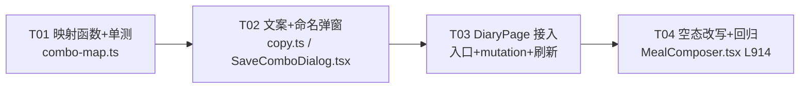

# 增量架构设计 —— 套餐模板「能新建」（GAP-2）

> 作者：架构师 高见远（arch-combo）
> 日期：2026-09-28
> 基线：`main` @ `3d669b8`
> 范围：**设计定案 + 施工任务分解**。本文档**不含业务代码**，不修改任何已跟踪文件，不提交 git。
> 关联：PRD R3.9（套餐模板，P0）；缺口审计 GAP-2；候选清单 C3（「和昨天一样」，已搁置）。

---

## 0. 问题复述（已核实，直接采信）

> 📌 **2026-10-02 更新**：本节记录的是 **2026-09-28 立项当时**的缺口状态，**该缺口已闭环** ——
> GAP-2 已交付（`a3692cb`「一餐可存成套餐」+ `9b57a8f`）。下表「前端是否调用」一列与「后果」段按原样保留作为设计依据，
> **当前状态以下方标注为准**：`POST /meal-combos` 现已由前端调用（`DiaryPage.tsx:331` `createComboMutation` + `SaveComboDialog.tsx`），
> 「套餐」tab 不再是只能显示空态。**本文档余下章节为当时的设计定案，保留备查。**

后端 R3.9 三件套齐全，但前端只接了「读」和「应用」，没接「建」（*—— 2026-09-28 立项时的状态*）：

| 端点 | 前端是否调用 | 证据 |
| --- | --- | --- |
| `GET /meal-combos` | ✅ 有 | `apps/web/src/pages/diary/MealComposer.tsx:329-333`（`comboQuery`） |
| `POST /meal-combos` | ❌ **零调用** | 全仓 `grep` 无命中 —— 📌 **2026-10-02 已交付**：`DiaryPage.tsx:331` `createComboMutation` + `SaveComboDialog.tsx`（`a3692cb`） |
| `POST /meal-combos/:id/apply` | ✅ 有 | `apps/web/src/pages/diary/DiaryPage.tsx:415` |

**后果**：`MealComposer.tsx` 的「套餐」tab 永远只显示空态 `还没有保存的套餐模板`（L914），
**没有任何入口能建出第一个套餐**。应用链路（`applyCombo`）通了，但**源头断了** ——
这是一个「功能半成品」，不是「优化项」。R3.9 属 P0，必须闭环。
📌 **2026-10-02：上述后果已消除** —— 命名弹窗 + 存套餐入口已落地，「一餐可存成套餐」闭环完成（`a3692cb`）。

---

## 1. 路径对比与定案

### 1.1 两条候选路径

**路径 A ——「把这一餐存成套餐」**（从日记页的某餐就地生成）
用户在 `DiaryPage` 的某一餐（已有一条或多条记录）点「存成套餐」→ 把该餐 `logs`
逐条映射为 `ComboItemDto[]` → `POST /meal-combos`。**零新增选食物流程**。

**路径 B ——「在套餐 tab 里从零新建」**（在 `MealComposer` 里逐条添加）
用户在套餐 tab 点「新建套餐」→ 逐条走一遍「选食物 → 定份量」→ 攒出一个「编辑中的套餐」
→ 提交。**需要一整套临时编辑态 + 复用选食物流程**。

### 1.2 四维对比

| 维度 | 路径 A（存这一餐） | 路径 B（从零新建） |
| --- | --- | --- |
| **自用场景真用率** | **高**。单人自用的真实动机就是「这顿搭配不错，下次照吃」——用户在**已经记完、看着这一餐的条目**时，脑子里才有「这个搭配值得存下来」的念头 | **低**。用户要凭空想起「我想预制一个模板」，然后在没有记录刺激的情况下逐条搜食物——这是**为功能而用功能**，不是生活里的动作 |
| **交互成本** | **一次点击**（一个按钮）+ 一次命名。食材、克数、热量**全部现成**（就是已记录的条目） | **N+2 次**（N 个条目各走一遍选食物+份量）。且要引入「编辑中的套餐」临时态、条目增删、取消恢复 |
| **新增状态复杂度** | **零新状态机**。只加一个「命名弹窗」的局部 `useState`（`namingOpen: boolean` + `comboName: string`） | 需 `draftItems: ComboItemDto[]` + `draftName` + 每条的编辑/删除 + 「提交前是否离开」的守卫 |
| **与既有功能重合度** | 与 C3「和昨天一样」**部分语义接近**，但**不重合**（见 §1.3） | 与 C3 几乎无关，但**与「记录一餐」的选食物流程重度重合**（等于把记录流程再实现一遍到套餐里） |

### 1.3 与 C3「和昨天一样」的关系（必须回答）

C3「复制昨天」被搁置的理由是**与套餐模板语义重合**（都是「把过去某天的搭配快速搬到今天」）。
本方案选择 A 之后，二者的边界必须讲清，否则「搁置」的理由会被推翻或反过来让套餐变重：

- **套餐是「显式保存的具名模板」**：用户主动挑一餐、起名、持久化。它是**用户自己的资产**，
  数量少、语义强（「我的减脂早餐」）。
- **C3 是「隐式复制整天」**：不分餐次、不起名、不持久化，复制的是**日历上的昨天**。

**判断**：**套餐变得好用之后，C3 更没必要做。** 理由：
① A 路径让「照吃某一餐」从「回头找昨天那条记录 → 手动一条条再记一遍」变成「点一下套餐的一键添加」——
**这正是 C3 想解决的问题**，且套餐还能跨天复用、可命名，能力更强；
② C3 会引入「昨天没记录 / 记录不全」的判定分支，复杂度不低，收益被套餐覆盖；
③ 结论：**建议 C3 保持搁置，并在候选清单里把「被 R3.9 套餐覆盖」写成明确理由**（这一条由 PM 侧落笔，不在本设计范围）。

> ✅ **本方案不会让 C3 更必要，反而更不必要**——符合团队「不制造重合」的要求。

### 1.4 定案

> ## 定案：**路径 A（只做「把这一餐存成套餐」）**，本轮**不做** B。

**核心理由 3 条：**

1. **动机对齐**：单人自用产品的真实动机是「这顿好，下次照吃」。A 在**用户已经有记录的那一刻**
   提供入口，是语义最自然、路径最短的落点；B 要求用户凭空起意，真用率低。
2. **成本极低且零新状态机**：A 的请求体字段与 `MealLog` **几乎一一对应**（见 §2.1），
   映射是一个纯函数；交互上只加「一个按钮 + 一个命名输入」，不存在「编辑中的套餐」这种临时态。
   B 需要新造一套编辑态 + 复用选食物流程，**成本是 A 的数倍，收益是 A 的子集**。
3. **不制造重合**：A 让 C3 更没必要（§1.3），符合「不重复建设」；B 则等于把记录流程抄进套餐 tab。

**路径 B 的诚实记录**：B 唯一覆盖 A 覆盖不了的是「**还没记录过、想先存个模板**」的场景。
判断：**接受这个缺口**——单人自用下，这个场景真用率极低（用户要凭空预制品类繁多的模板），
且用户完全可以「先随便记一餐 → 存成套餐 → 删掉那餐记录」绕过去，**代价远低于新造一套编辑态**。
若未来出现真实诉求，B 可作为**独立增量**追加，届时 A 的 `POST /meal-combos` 契约（§2.2）
**完全不需要改动**，A+B 可平滑演进。

---

## 2. 具体文件级设计（定案 A）

### 2.0 改动文件清单（共 6 个文件：4 改 + 2 新增）

| # | 文件 | 动作 | 说明 |
| --- | --- | --- | --- |
| 1 | `apps/web/src/lib/combo-map.ts` | **新增** | 「`MealLog[]` → `ComboItemDto[]`」纯函数 + 单元测试目标 |
| 2 | `apps/web/src/pages/diary/SaveComboDialog.tsx` | **新增** | 命名弹窗（复用 `MealPortionEditor` 的弹窗结构与 UI 规范） |
| 3 | `apps/web/src/pages/diary/DiaryPage.tsx` | 修改 | 每餐卡片头加「存成套餐」入口 + `useMutation(postCombo)` + 成功刷新 |
| 4 | `apps/web/src/lib/copy.ts` | 修改 | 新增 `COPY.*` 文案（**与 GAP-1 冲突点**，见 §5） |
| 5 | `apps/web/src/lib/queryClient.ts` | 修改 | ⚠️ **无需改动** —— `queryKeys.combos` 已存在（L51）。列入清单仅为显式确认 |
| 6 | `apps/web/src/pages/diary/combo-map.test.ts` | **新增** | 纯函数单测（与仓内既有 `*.test.ts` 同风格） |

> 说明：不改 `apps/api`（后端三件套已就绪）；不改 `packages/shared-types`（
> `MealComboItemInput` / `MealComboRequest` 已定义，直接复用）。
> 静安：不改 `MealComposer.tsx`（**这是本方案相对 B 的关键优势——GAP-1 正在改这个文件**，见 §5）。
> `SaveComboDialog.tsx` 与 `combo-map.ts` **在同名目录**，注意与 `MealPortionEditor.tsx` 并列。

### 2.1 映射契约：`MealLog` → `ComboItemDto`（路径 A 的核心，几乎零阻抗）

已核实 `MealLog` 字段（`packages/shared-types/src/entities.ts:316-346`）与
`ComboItemDto`（`apps/api/src/meals/dto/combo.dto.ts:26-99`）**一一对应**：

| `MealLog` 字段 | → `ComboItemDto` 字段 | 说明 |
| --- | --- | --- |
| `foodItemId: number \| null` | `foodId?: number` | `null` → **省略该字段**（不能传 `null`，DTO 是 `@IsOptional` 数字） |
| `customName: string \| null` | `customName?: string` | 自定义条目必带；库内条目可带（后端 `prepareComboItem` 接受） |
| `grams: number \| null` | `grams?: number` | 直接透传 |
| `servingUnit: string \| null` | `servingUnit?: string` | 直接透传 |
| `servingQty: number \| null` | `servingQty?: number` | 直接透传 |
| `kcal: number` | `kcal?: number` | **必传**（自定义条目后端强校验 `kcal` 必填） |
| `proteinG / fatG / carbG: number \| null` | `proteinG / fatG / carbG?: number` | 直接透传 |
| `（分组内下标）` | `sortOrder?: number` | 用该餐内 `logs` 下标，**保住套餐明细顺序**（`applyCombo` 按 `sortOrder || id` 排） |

**纯函数设计**（`apps/web/src/lib/combo-map.ts`）：

```ts
import type { ComboItemDto, MealLog } from '@qsh/shared-types';

/**
 * 把「某一餐已记录的条目」映射为套餐明细输入。
 *
 * 关键不变量：
 * - `foodItemId === null` 的条目**必须**带 `customName` 与 `kcal`（后端 prepareComboItem 强校验）；
 * - 库内条目也带 `customName`（= 记录时的展示名），让套餐明细在任何时候都能显示人话名称；
 * - `sortOrder` 用数组下标，保证「照这个搭配再记一次」的顺序与用户看到的一致（AC-3.8.5）。
 *
 * 返回的条目**只含非空字段**（`undefined` 的键不出现），避免把 `null` 当成数字传下去。
 */
export function mealLogsToComboItems(logs: readonly MealLog[]): ComboItemDto[];
```

> **可测试性**：纯函数、无副作用、不依赖 react-query / DOM —— 单测直接构造 `MealLog[]` 断言输出，
> 覆盖「库内条目 / 自定义条目 / 混合 / 空数组」四类输入。

### 2.2 调用的 API

**请求**（复用既有后端，零改动）：

```
POST /meal-combos
Content-Type: application/json

{
  "name": "我的减脂早餐",           // 必填，trim 后非空
  "mealType": "breakfast",          // 可选；本方案**传当前餐次**，缺省后端按 breakfast
  "items": [
    { "foodId": 42, "customName": "全脂牛奶", "grams": 250, "servingUnit": "杯",
      "servingQty": 1, "kcal": 134, "sortOrder": 0 },
    { "customName": "楼下豆浆", "kcal": 90, "grams": 300, "sortOrder": 1 }
  ]
}
```

> ⚠️ `mealType` **是否要传**：`CreateComboDto.mealType` 是「套餐的默认餐次」，缺省 `breakfast`。
> 但**它不影响 `applyCombo`**（`applyCombo` 用调用方传入的 `dto.mealType ?? combo.mealType`，
> 而前端 `DiaryPage.handleSubmit` 在应用时**总是显式传当前餐次**，见 L415）。
> 建议：**仍然传当前餐次**，让套餐自带一个合理的默认值（将来若做「从套餐 tab 直接应用」会更自然），
> 且不产生任何副作用。→ 见 §6 待确认 Q-1。

**期望响应**：`MealComboWithItems`（`MealCombo & { items: MealComboItem[] }`），
HTTP 201。前端**只需要 `id` / `name`** 用于提示与缓存刷新，其余字段忽略。

**错误**：
- `409 VALID_DUPLICATE`，`message` = `已经有一个同名套餐了，换个名字试试`（后端 `meals.service.ts:527`）；
- `400 VALID_INPUT`：名称为空 / 明细缺名称 / 自定义条目缺热量。

### 2.3 状态管理（react-query）

本项目**不用乐观更新**处理「新建」——新建的 `id` 由服务端生成，乐观插入会造一个假 id，
且套餐列表不是高频热路径，**简单即可**：

```ts
// DiaryPage.tsx 内
const qc = useQueryClient();

const saveCombo = useMutation({
  mutationFn: (body: MealComboRequest) =>
    api.post<MealComboWithItems>('/meal-combos', body),
  onSuccess: async (combo) => {
    // ① 让套餐 tab 立即看到新套餐（关键：comboQuery 的 enabled 是 tab==='combo'，
    //    用户切回套餐 tab 时必须命中最新数据）
    await qc.invalidateQueries({ queryKey: queryKeys.combos });
    // ② 温和反馈 + 收起弹窗
    setSaveComboMeal(null);
    setAnnouncement(saveComboDoneLine(combo.name));   // copy.ts
    setNotice(null);
  },
  onError: (error) => {
    // 409 / 400 走服务端文案（noticeFromError 已把 message 透出，见 lib/api.ts:70）
    setNotice(noticeFromError(error, COPY.comboSaveFailed));  // 见 §3
  },
});
```

- **query key**：`queryKeys.combos`（`['meal-combos']`，`queryClient.ts:51`）——**已存在，不新增**。
  与 `MealComposer.tsx:330` 的 `comboQuery` **同一个 key** ⇒ 这里 invalidate 后，
  用户切到套餐 tab 拿到的是新列表（react-query 缓存去重，切 tab 不会重复请求）。
- **乐观更新**：**不做**。理由：新建是低频一次性动作，且需要服务端返回的 `id`；
  先 `invalidate` 再让套餐 tab 自然重取，逻辑最短、最不易错。
- **离线**：**不入离线队列**（`enqueueRequest`）。理由：新建套餐是「用户主动、可稍后再做」的动作，
  不像记录三餐那样有时间敏感性；且离线队列重放需要幂等保障（同名 409 会**永久堵死队列** ——
  这正是 `P0-5 离线队列永久堵死` 的同类陷阱）。离线时给 `COPY.comboSaveOffline`（见 §3），
  **明确告知没有保存、联网后再来**，比「假装入队」更诚实。→ 见 §6 待确认 Q-3。

### 2.4 `DiaryPage.tsx` 的组件改动（具体到位置）

当前每餐卡片的结构（`DiaryPage.tsx:694-767`）：
```
<section>  ← 每餐
  <div class="flex items-center justify-between">   ← L709 头部：餐次名 + 热量
    <h2>{MEAL_TYPE_LABELS[group.mealType]}</h2>
    <p>{本餐热量}</p>
  </div>
  {logs.length === 0 ? <p>还没有记录…</p> : <ul>…</ul>}
  <button>+ 记录{餐次}</button>                      ← L758
</section>
```

**入口摆放**：在**本餐有条目时**（`group.logs.length > 0`），于 `+ 记录{餐次}` 按钮**同行左侧**
（或紧随其下）加一个次级按钮「存成套餐」：

```tsx
{group.logs.length > 0 && (
  <button
    type="button"
    data-testid={`save-combo-${group.mealType}`}
    onClick={() => { setSaveComboMeal(group.mealType); }}
    className="qsh-touch-target ... 次级样式"
  >
    {COPY.comboSaveEntry}
  </button>
)}
```

**新增 state**（与既有 `composerMeal` / `editingLog` 并列）：
```ts
/** 正在「存成套餐」的餐次（`null` = 弹窗未打开）。 */
const [savingComboMeal, setSavingComboMeal] = useState<MealGroup['mealType'] | null>(null);
```

**默认套餐名**（提升一次成功率）：命名输入框的初值用**餐次 + 日期**生成，
建议 `comboDefaultName(mealLabel)` = `${mealLabel}（${monthDay}）`，如 `早餐（9月28日）`；
用户可改可留，**不预填就用不了**的问题被规避掉。

**弹窗挂载**（与 `MealPortionEditor` 同层，`DiaryPage.tsx:778` 附近）：
```tsx
{savingComboMeal !== null && (
  <SaveComboDialog
    mealType={savingComboMeal}
    logs={groups.find(g => g.mealType === savingComboMeal)?.logs ?? []}
    defaultName={comboDefaultName(...)}
    busy={saveCombo.isPending}
    onCancel={() => setSavingComboMeal(null)}
    onSubmit={(name) => saveCombo.mutate({
      name,
      mealType: savingComboMeal,
      items: mealLogsToComboItems(logsOfThatMeal),
    })}
  />
)}
```

### 2.5 关键边界处理（逐条给结论）

| 边界 | 结论 | 理由 |
| --- | --- | --- |
| **空餐次能不能存** | **不能**。`group.logs.length === 0` 时**不渲染**「存成套餐」入口 | 空餐存出去是一个**空明细套餐**，`createCombo` 不拦（`items: []` 合法，Prisma `create` 空数组 OK）→ 会产生一个「一键添加后什么都没记」的僵尸套餐。**入口不出现**是比「点了再报错」更好的处理（不留空卡、不给无效动作） |
| **自定义条目（`foodItemId=null`）能不能存** | **能**。带 `customName` + `kcal` | 后端 `prepareComboItem` 明确支持自定义条目（L673-695）；且这是单人自用最常见的情况（楼下麻辣烫）。`mealLogsToComboItems` 必须保证这两字段非空 |
| **混合条目**（库内 + 自定义） | **能**。逐条按上表映射 | 后端逐条 `prepareComboItem`，两类可共存 |
| **同名 409 怎么温和提示** | **就地提示、不关弹窗、保留已填名字**，文案=`已经有一个同名套餐了，换个名字试试`（**直接用服务端 message**，已过审且措辞温和），并在提示旁给一句引导。**不用红色**、**不说「失败」** | 这是「提供选择」，不是「纠正错误」——与 C1 快速加卡同名提示（`MealComposer.tsx:876`）**同一套调性**。保留名字让用户改一个字就能重提交 |
| **名称为空** | 前端先拦：`name.trim() === ''` → 禁用提交按钮（或点后给 `COPY.comboNameRequired`），**不发请求** | 与 `MealComposer` 快速加卡「填一下名称和热量就能记下啦」同风格 |
| **超长名称** | 前端**不设上限**，交给后端 | 后端 DTO 无长度约束；不新增规则（不重复建设） |
| **套餐条目上限** | 前端**不设限**，由本餐条目数自然决定 | 本餐能有几条，套餐就有几条；不额外造规则 |

---

## 3. 文案建议（放入 `copy.ts`）

### 3.1 新增 `COPY` 常量

```ts
/* ---------------------------------------------------------------------------
 * 套餐新建（R3.9 / GAP-2）—— 语气规范同 §7：把「存成套餐」说成一件顺手的小事。
 * 不催用户「多存几个」，不设目标数，空态也不把「没有套餐」写成亏欠。
 * ------------------------------------------------------------------------- */

/** 入口按钮：动作导向、口语、2~4 字 */
comboSaveEntry: '存成套餐',
/** 命名弹窗标题（疑问句 → 不是命令） */
comboSaveTitle: '给这一餐起个名字',
/** 命名弹窗说明：讲清「存下来会怎样」，减少不确定感 */
comboSaveDesc: '存好之后，下次可以在「套餐」里点一下就记回来。',
comboNameLabel: '套餐名字',
comboNamePlaceholder: '比如：我的常规早餐',
comboSaveConfirm: '存下来',
comboSaveCancel: '先不存',
/** 名称未填时的中性提示（不指责） */
comboNameRequired: '填个名字就能存下来了',
/** 保存成功（正向、轻） */
comboSaveDone: '存好啦，下次在「套餐」里就能一键记回来',
/** 保存失败兜底（业务错误时优先用服务端文案；这里是网络 / 未知错误的兜底） */
comboSaveFailed: '这次没存上，稍后再试一次就好',
/** 离线时的诚实告知（不入离线队列，见 §2.3） */
comboSaveOffline: '现在网络好像不太稳，联网了再来存一次就好',
/** 套餐 tab 空态改写（L914）—— 关键：指一条明路，而不是把空说成缺失 */
comboEmpty: '还没有套餐。在饮食记录里挑一餐，点「存成套餐」就有了',
```

### 3.2 正例 / 反例对照（守住无负罪感调性）

| 位置 | ✅ 正例（采纳） | ❌ 反例（禁止） | 为什么反例不行 |
| --- | --- | --- | --- |
| 空态 | 「还没有套餐。在饮食记录里挑一餐，点『存成套餐』就有了」 | 「你还没有创建任何套餐模板！」 | 把「空」说成「你的疏漏」；感叹号像催促 |
| 名称未填 | 「填个名字就能存下来了」 | 「套餐名称不能为空！」/「必填项缺失」 | 表单申诉口吻；把没填名说成错误 |
| 同名 409 | 「已经有一个同名套餐了，换个名字试试」 | 「名称重复，创建失败（错误码 409）」 | 暴露错误码 + 「失败」评判用户 |
| 成功 | 「存好啦，下次在『套餐』里就能一键记回来」 | 「套餐创建成功！已为你节省 N 次操作」 | 自我表功；把便利说成业绩 |
| 离线 | 「现在网络好像不太稳，联网了再来存一次就好」 | 「保存失败，请检查网络连接后重试」 | 「请…重试」是命令式；红色语义恐吓 |

> **统一口径**：全部沿用仓内既有模式（`favoriteFailed` / `reorderFailed` 的
> 「这次没…，稍后再试试」），**不使用红色**、**不用「失败 / 错误」作标题**、
> **不出现评分 / 等级 / 徽章**类词。

---

## 4. 红线自检

### 4.1 无负罪感 ✅
- 入口 / 弹窗 / 提示**全部是陈述或邀请**，无「应该 / 必须 / 至少 / 建议存 N 个」；
- 空态**指去路**，不把「没有套餐」渲染成亏欠（沿用 GAP-1 `favoriteEmpty` 的处理方式）；
- 同名 / 离线提示**不用红色**、**不用「失败」作标题**，沿用全站口径；
- **不新增任何催促**（不做「你还没建套餐」提醒、不做引导气泡）。

### 4.2 NFR-11 可解释性 —— 明确判断

> **判断：本功能不产生任何「新数字」，`/why-numbers` 无需新增条目。**

逐点论证：

1. **本功能展示的数字，全部是既有的、已被 `MealComboItem.kcal / proteinG / fatG / carbG` 承载的值**，
   它们**来源与记录一餐完全相同**（同一个食物库 `kcalPer100g` + 同一个份量换算 `scaleFoodNutrients`，
   见 `meals.service.ts:642-696`）。也就是说，套餐条目上的热量不是**新算出来的**，
   而是**把用户已记录的那条原样搬过来**（`mealLogsToComboItems` 是纯搬运，不做任何计算）。
2. **弹窗内是否要展示套餐合计热量？** —— **设计上明确不展示**。
   命名弹窗只出现：餐次名、条目**名称列表**、一个名字输入框。**不出现合计 kcal**。
   这样最彻底地规避了「引入新数字」。
3. **✅ 结论**：本功能的数字**全部可溯源到既有链路**，`/why-numbers` **不需要补条目**。
   与本功能相关的「热量怎么算」条目**早已存在**（`WhyNumbersPage.tsx` 的「热量预算 / 食物单位换算」块），
   本功能只是复用，**不新增口径**。

> 若未来有人想在弹窗里加「套餐合计 kcal」：那**仍是既有口径**（逐条 kcal 求和，
> 与 `sumKcal` 同源），依然不算新数字、无需 `/why-numbers` 条目；但**本轮定案不加**（保持最简）。

### 4.3 数据主权 ✅
单人自用、无云端同步、无多用户协作。套餐是**本用户私有数据**（`userId` 过滤，
`listCombos` / `createCombo` 均带 `where: { userId }`）。前端不新增任何上报 / 埋点。

### 4.4 不重复建设 ✅
- **API 复用**：零后端改动，直接用 `POST /meal-combos`；
- **不重造排序**：`applyCombo` 的 `nextSortOrder`（AC-3.8.5）已就绪，本方案只负责**生成明细的 `sortOrder`**；
- **不造编辑态**：这是相对路径 B 的核心优势——零新状态机；
- **与 C3 边界清晰**：§1.3 已论证，套餐变好用 ⇒ C3 更没必要（本方案**不**增加重合）；
- **文案复用**：同名提示复用服务端 message（与 C1 同调性），不另造一套。

### 4.5 埋点 ✅（项目无埋点，本行按 team-lead 指示略）

---

## 5. ⚠️ 与 GAP-1（收藏）的并行改动冲突点 —— 必须协调

已核实工作区 `git status`：**GAP-1 工程师正在修改**
`apps/web/src/pages/diary/MealComposer.tsx` 与 `apps/web/src/lib/copy.ts`（未提交）。

| 文件 | GAP-1 已改动的内容（工作区实测） | 本设计是否触碰 | 冲突等级 | 协调动作 |
| --- | --- | --- | --- | --- |
| `apps/web/src/lib/copy.ts` | 新增 `favoriteEmpty` / `favoriteEmptyRecent` / `favoriteFailed` + `favoriteToggleAria()`（`git diff` 实测，插在 L202 与 L629 附近） | **要新增** §3.1 的 `combo*` 常量 | 🟡 **低（可机械合并）** | 本方案**只追加**新键、**不修改**任何既有键。建议 `combo*` 常量**插在 `favorite*` 之后、`foodCategory*` 之前**，避免与 GAP-1 的同一行区间打架。落地时**先 rebase/合并 GAP-1 的 copy.ts**，再在此之上追加 |
| `apps/web/src/pages/diary/MealComposer.tsx` | 改 `favoriteQuery.enabled`（L326 附近）+ 新增 `favoriteIds` / `favoriteMutation` / `toggleFavorite`（**共 +90 行左右**，插入在 `topQuery` 与 `comboQuery` 之间） | **不改** | 🟢 **无冲突** | 本方案**刻意不动 `MealComposer.tsx`**。唯一关联点是：§3.1 的 `comboEmpty`（L914 空态改写）**位于该文件**，而 GAP-1 的插入点在**上方的 `favoriteQuery` 区**（L320-410）——两者**行区间不重叠**，但**同文件**。落地时如遇上下文冲突，以「保留双方改动」为准 |
| `apps/web/src/pages/diary/DiaryPage.tsx` | **GAP-1 未改动**（实测 diff 无此文件） | **要改**（§2.4） | 🟢 **无冲突** | 本方案的主要落点在 `DiaryPage.tsx`，与 GAP-1 **物理隔离** |

**结论**：**本方案与 GAP-1 冲突点仅 1 处（`copy.ts` 追加位置），且为「同文件不同区块」的低风险合并**；
`MealComposer.tsx` 的空态改写（L914）与 GAP-1 的改动区块不重叠，但**同文件**，落地时需
**在 GAP-1 合入之后**再做，避免行号漂移导致的 patch 失败。

**给工程的落地建议**：**GAP-1 先合，GAP-2 后落**；两者都动 `copy.ts`，
合并顺序反了会多一次手工解冲突。

---

## 6. 任务分解（T01 → T04，共 4 个任务）

> 依赖关系：T01 → T02 → T03 → T04（T02 之后 T03/T04 可并行，但建议顺序执行以简化联调）。

### T01 — 纯映射函数 + 单测（无 UI 依赖，可先做）
- **改动**：新增 `apps/web/src/lib/combo-map.ts`、`apps/web/src/pages/diary/combo-map.test.ts`
- **做什么**：实现 `mealLogsToComboItems(logs: readonly MealLog[]): ComboItemDto[]`：
  - 库内条目：`foodId` 直传、`customName` 直传、`grams/servingUnit/servingQty/kcal/营养素` 直传、`sortOrder` = 下标；
  - 自定义条目（`foodItemId === null`）：**不带 `foodId` 键**、必带 `customName` + `kcal`；
  - `null` 字段**不写进对象**（不用 `undefined` 占位产生键）；
  - 空数组 → 返回 `[]`。
- **怎么自测**：`pnpm -C apps/web test combo-map`（或仓内既有测试命令）；
  断言四类输入：全库内 / 全自定义 / 混合 / 空；并断言**没有任何 `null` 值**、**无 `foodId: undefined` 键**。

### T02 — 文案 + 命名弹窗组件
- **改动**：`apps/web/src/lib/copy.ts`（追加 §3.1）、新增 `apps/web/src/pages/diary/SaveComboDialog.tsx`
- **做什么**：
  - `copy.ts`：新增 `combo*` 常量（**追加，不改既有键**，见 §5 冲突协调）；
  - `SaveComboDialog.tsx`：`role="dialog" aria-modal="true"`、标题、说明、名字输入框（初值 `defaultName`）、
    条目**名称列表**（**不显示热量**，见 §4.2）、确认 / 取消按钮；
    确认时 `if (name.trim() === '')` → 显示 `COPY.comboNameRequired` 并 return；
    **UI 规范对齐 `MealPortionEditor.tsx`**：`qsh-touch-target`（≥44×44）、`rounded-control`、
    `duration-qsh-base ease-qsh-out`、12px 文字 `slate-600/dark:slate-300`。
  - `onSubmit(name: string)` 交给父组件；`busy` 时按钮 `disabled:opacity-60` 且文案切换。
- **怎么自测**：Storybook 无 → 直接在 T03 接入后手测；本步先保证组件**无 TS 报错、能被 import**。

### T03 — DiaryPage 接入（入口 + mutation + 刷新）
- **改动**：`apps/web/src/pages/diary/DiaryPage.tsx`
- **做什么**：
  - 新增 `savingComboMeal` state（§2.4）；
  - 每餐卡片：`group.logs.length > 0` 时渲染 `存成套餐` 按钮（`data-testid` 便于测试）；
  - 新增 `saveCombo = useMutation(...)`（§2.3）：成功 → `invalidateQueries(queryKeys.combos)` + `announcement` + 关弹窗；
    失败 → `noticeFromError(error, COPY.comboSaveFailed)`，**不关弹窗**；
  - 挂载 `SaveComboDialog`，`onSubmit` 用 `mealLogsToComboItems(...)` 构造 body（§2.2）；
  - 离线（`isNetworkError`）→ `setNotice(COPY.comboSaveOffline)`，**不入队**、**不关弹窗**。
- **怎么自测**：
  1. 记一餐 → 该餐出现「存成套餐」；空餐**不出现**按钮；
  2. 点按钮 → 弹窗、默认名已填；清空名字 → 提示且不提交；
  3. 提交正常名 → 成功播报、弹窗关；
  4. **切到 MealComposer 套餐 tab → 新套餐在列表里**（验证 `queryKeys.combos` 同源失效）；
  5. 用同名再存 → 409 温和提示、弹窗保留、改名后成功；
  6. 含自定义条目（快加）的一餐 → 能存成套餐；应用该套餐 → 条目正常落库。

### T04 — 空态改写 + 回归与边界收口
- **改动**：`apps/web/src/pages/diary/MealComposer.tsx`（**仅 L914 一行文案** → `COPY.comboEmpty`）、
  `apps/web/src/lib/copy.ts`（若 T02 未加则补）
- **做什么**：
  - 把 `还没有保存的套餐模板` 换成 `COPY.comboEmpty`（指一条明路）；
  - **⚠️ 与 GAP-1 协调**：本步**放在 GAP-1 合入之后**做（同文件，避免行号漂移）；
  - 回归：套餐 tab 在「有套餐 / 无套餐」两态下的渲染；
  - 跑 `typecheck` + 既有相关测试（`MealComposer` / `DiaryPage` 若已有测试）。
- **怎么自测**：全新用户进套餐 tab → 看到 `还没有套餐。在饮食记录里挑一餐，点「存成套餐」就有了`；
  建一个后 → 空态消失、列表出现、一键添加可用。

**任务依赖图**：



---

## 7. 待确认问题（含建议默认值）

| # | 问题 | 建议默认值 | 理由 |
| --- | --- | --- | --- |
| **Q-1** | `POST /meal-combos` 是否传 `mealType`？ | **传当前餐次** | `applyCombo` 由调用方餐次覆盖，传了无副作用，还能让套餐自带合理默认（§2.2） |
| **Q-2** | 弹窗里是否展示套餐**合计热量**？ | **不展示** | 最彻底地规避 NFR-11「新数字」问题（§4.2）；本轮保持最简 |
| **Q-3** | 离线时新建套餐是否入 `enqueueRequest` 离线队列？ | **不入队**，给 `COPY.comboSaveOffline` 诚实告知 | 新建是「可稍后再做」的低频动作；入队重放遇同名 409 会**永久堵队列**（P0-5 同类陷阱） |
| **Q-4** | 默认套餐名格式？ | `早餐（9月28日）`（餐次 + 月日） | 规避「不填名就用不了」；用户可改可留 |
| **Q-5** | 套餐名是否允许多个同名（仅大小写 / 空格不同）？ | **沿用后端**：`trim` 后精确匹配，409 拦 | 前端**不新增**去重规则，不重复建设 |
| **Q-6** | 是否需要「从套餐 tab 也能新建」（路径 B）？ | **本轮不做** | §1.4 已论证；未来做时 A 的 API 契约无需改动，可平滑追加 |
| **Q-7** | 入口是否也放在 `MealComposer` 的套餐 tab（引导新建）？ | **不**。仅空态给一句指路文案 | 与 GAP-1 同文件，避免并行改动；且会让套餐 tab 变复杂（引入编辑态） |

---

## 8. 交付自检

- [x] **只写文档**，未写业务代码，未改任何已跟踪文件（仅新增本 `.md`）
- [x] **未提交 git**（工作区另有 GAP-1 未跟踪/已修改文件，未混入）
- [x] 定案明确（**A**），理由 3 条，含与 C3 的边界判断
- [x] 落到「具体文件 + 具体函数名 + 具体契约」（`mealLogsToComboItems` / `SaveComboDialog` / `POST /meal-combos` body）
- [x] 状态管理明确（`queryKeys.combos` 复用、**不做乐观更新**、`invalidateQueries` 刷新）
- [x] 边界逐条给结论（空餐 / 自定义条目 / 混合 / 409 / 空名）
- [x] 文案正例反例对照，守无负罪感
- [x] NFR-11 明确判断（**不新增条目**）+ 论证
- [x] 任务分解 T01→T04，每步「改什么文件 / 做什么 / 怎么自测」
- [x] **GAP-1 冲突点已显式标注**（`copy.ts` 追加位置；`MealComposer.tsx` 同文件需后落）
