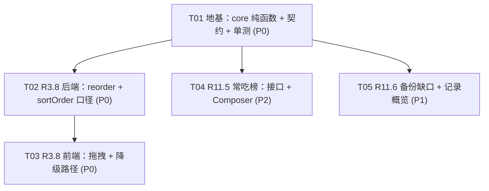

# 「轻生活」增量架构设计 —— 补完三项（R3.8 / R11.5 / R11.6）

| 项目信息 | 内容 |
| --- | --- |
| 文档语言 | 简体中文 |
| 文档类型 | **增量架构设计 + 任务分解（面向工程师逐条执行）** |
| 上游需求 | `docs/PRD-增量-R11x-未完成功能本轮.md` §4.1（R3.8）/ §4.4（R11.5）/ §4.5（R11.6） |
| 上游架构 | `docs/ARCHITECTURE.md` v1.0（§7 共享知识 K1~K11 全部继承，本文不再复述） |
| 作者 | 高见远（架构师） |
| 版本 | v1.0（收窄版：只做「半做」的三项） |
| 范围 | **R3.8 餐间拖拽排序（P0）/ R11.5 我的常吃榜（P2）/ R11.6 备份缺口补齐（P1）** |

> **本轮边界**
> - **不做**：R11.3 阶段回顾、R11.4 体重之外的变化（`win_logs` 新表）、R11.7 饮食多样性计数 —— 这三项是「完全没做」的新建项，用户本轮只要「半做的」。
> - **不新增任何数据表**，**不新增任何 npm 依赖**，**不改 Prisma schema**。
> - 本文只做设计；业务代码由工程师按 §6 任务列表执行。

---

## 0. 一页速览

| 需求 | 落点 | 关键事实 |
| --- | --- | --- |
| **R3.8** | `core/meal/reorder.ts`（新）+ `meals.service/controller`（改）+ `DiaryPage` 系（改/新） | **唯一真坑**：`sort_order` 列早就有，但服务端新增时**不分配**（前端 `DiaryPage.tsx:232` 硬编码 `0`）。不修 → 拖完顺序后新记的一条永远插最前 |
| **R11.5** | `core/food/identity.ts` + `core/food/frequency.ts`（新）+ `foods.service/controller`（改）+ `MealComposer`（改） | 现有 `/foods/recent` 是**时间倒序去重**，不是频次。本轮**另开 `/foods/top`**，不动 `/recent`（避免回归） |
| **R11.6** | `data.service/controller`（改）+ `SettingsDataPage` + `DataOverviewCard`（改/新）+ `copy.ts`（改） | C6 基座（`backup.ts` / `lastBackupLabel` / `data-testid="last-backup"`）**整体冻结为回归保护**，只加两样东西 |

---

## 1. 整体方案与分层改动说明

### 1.1 分层职责划分

```
packages/core        ← 纯计算口径的唯一真源（零 IO、零依赖）
                        · applyReorder        R3.8 排序/跨餐移动的映射计算
                        · foodIdentity / distinctFoodKeys   食物身份归一（R11.5 自用，口径预留给 R11.3/R11.7）
                        · rankFrequentFoods  常吃榜排名（出现天数口径）
packages/shared-types ← 前后端唯一契约（只加类型，不加逻辑）
                        · ReorderMealsRequest/Response · TopFoods* · DataOverview*
apps/api             ← SQL 下推（groupBy / aggregate）+ 鉴权 + 事务
                        · PATCH /meals/reorder · GET /foods/top · GET /data/overview
apps/web             ← 渲染 + Pointer Events 交互 + 离线乐观更新
```

**为什么口径函数必须下沉 `core`**：R3.8 的排序结果前端要乐观更新、服务端要落库；R11.5 的「出现天数」计数前端要在 Composer 里展示「12 天」、服务端要排序取前 12。两端各写一份必然漂移（本项目已有 QA BUG-01 的前车之鉴：响应形状与 `shared-types` 漂移）。`core` 零依赖、可单测，是唯一正解。

### 1.2 三条需求的落层理由

| 需求 | 为什么这样分 |
| --- | --- |
| **R3.8** | 排序映射是纯计算 → `core`；事务与越权校验是 IO → `api`；拖拽手势与降级控件是交互 → `web`。**接口只描述「目标餐次 + 该餐的完整期望顺序」**，不描述「从哪移到哪」，这样上移/下移/跨餐/拖拽四种操作共用同一条接口 |
| **R11.5** | 频次聚合必须由 SQL `groupBy` 下推（近 90 天可能上千条 `meal_logs`）；但「身份归一 + 出现天数计数 + tie-break」必须与前端展示一致 → 下推到 `(foodItemId, customName, loggedDate)` **最小投影**，再交给 `core` 归一 |
| **R11.6** | 纯渲染层 + 一个只读聚合接口。基座已存在，**禁止重构**（AC-11.6.1） |

### 1.3 关键设计决策（含对 PM 方案的偏离说明）

| # | 决策 | 说明 |
| --- | --- | --- |
| **D-1** | `PATCH /meals/reorder` 的 `orderedIds` 语义 = **目标餐次的完整期望顺序** | PM 原文只说「按 `orderedIds` 顺序赋 sortOrder = index」。若只传「被移动的那一条」，跨餐后源餐会留下空洞且无法表达一餐内的整体重排。传完整列表可让上移/下移/跨餐/拖拽四种操作**复用同一条接口**，且天然幂等 |
| **D-2** | `applyReorder` 额外做 **compact（重排所有餐次归零归一）** | 默认开启。跨餐移动后源餐会留下 `0,2,3` 这类空洞；虽然排序结果仍正确，但会随时间漂移。归零归一是幂等的（同一 payload 重复提交结果一致），符合 AC-3.8.3 |
| **D-3** | R11.5 **另开 `/foods/top`，不动 `/foods/recent`** | `/recent`（时间倒序去重）是 MealComposer「最近」tab 的既有数据源，改动它会造成回归。两者语义不同，并列存在 |
| **D-4** | 食物身份口径：**归一化显示名称优先，缺失回落 `foodItemId`** | 沿用 PM QR-1 旁的既定口径（AC-11.5.1 / AC-11.7.2）。理由：「种类」是用户的语言，用户认识的是名字。库内条目与同名快加条目应合并为 1 种 |
| **D-5** | `/foods/top` 的**最小投影**是 `groupBy([foodItemId, customName, loggedDate])` | AC-11.5.8 要求 P95 < 300ms 且不得把原始记录拉进内存。「出现天数」在数学上**无法**用比「（身份候选，日期）二元组」更小的数据算出 —— 这是最小必要投影，不是妥协 |
| **D-6** | 名称解析两阶段：先 `groupBy` 得到候选 `foodItemId` 集合，再**一次** `foodItem.findMany({ id: { in } })` 取名字 | `meal_logs` **不存**食物名（只有 `customName` 与 `foodItemId`）。一次 `in` 查询避免 N+1，也避免把 join 塞进 groupBy |
| **D-7** | **零 DDL 变更** | `meal_logs.sort_order` 已存在；`ix_meal_user_date_type` 索引已覆盖 reorder 的过滤条件；R11.6 不需要新表 |
| **D-8** | **零新增 npm 依赖**（QR-7） | 拖拽手写 Pointer Events，项目已有手写 SVG 图表（去掉 echarts）的先例 |

---

## 2. 完整文件清单

> 图例：**[新]** 新建 · **[改]** 修改 · **[冻]** 冻结（回归保护，**只能读、不许重构/删除**）

### 2.1 `packages/core`（新增 6 / 修改 1）

| 路径 | 职责 | 状态 |
| --- | --- | --- |
| `packages/core/src/food/identity.ts` | `normalizeFoodName` / `foodIdentity` / `distinctFoodKeys` —— 食物身份归一与去重 | **[新]** |
| `packages/core/src/food/frequency.ts` | `rankFrequentFoods` —— 常吃榜排名（出现天数口径 + 稳定 tie-break） | **[新]** |
| `packages/core/src/meal/reorder.ts` | `applyReorder` —— 餐内排序 / 跨餐移动的映射计算 | **[新]** |
| `packages/core/src/index.ts` | 追加上述导出（现有 147 行，追加到最后） | **[改]** |
| `packages/core/test/food-identity.test.ts` | 身份归一单测 | **[新]** |
| `packages/core/test/food-frequency.test.ts` | 常吃榜单测 | **[新]** |
| `packages/core/test/meal-reorder.test.ts` | 排序/跨餐单测 | **[新]** |

> ⚠️ `core` **禁止** import `@qsh/shared-types`（会造成 core ↔ shared-types 循环依赖，当前是 shared-types → core 单向）。`applyReorder` 用泛型 `T extends string` 承接 `MealType`（见 §5.3）。

### 2.2 `packages/shared-types`（修改 1）

| 路径 | 职责 | 状态 |
| --- | --- | --- |
| `packages/shared-types/src/api.ts` | 新增 3 组请求/响应契约（见 §4） | **[改]** |

> `entities.ts` 的 `MealLog.sortOrder`（L352）**已存在**，不动。

### 2.3 `apps/api`（新增 1 / 修改 5）

| 路径 | 职责 | 状态 |
| --- | --- | --- |
| `apps/api/src/meals/dto/reorder-meals.dto.ts` | `PATCH /meals/reorder` 的 class-validator DTO | **[新]** |
| `apps/api/src/meals/meals.service.ts` | ① 新增 `reorder()`；② **新增 `nextSortOrder()` 并接入 `create()` / `quickAdd()` / `applyCombo()`**（AC-3.8.5 核心） | **[改]** |
| `apps/api/src/meals/meals.controller.ts` | 新增 `@Patch('reorder')`（当前只有 GET/POST/quick-add/DELETE，**无 PATCH**） | **[改]** |
| `apps/api/src/foods/foods.service.ts` | 新增 `top(userId, days, limit)`（SQL groupBy 下推 + 名称解析 + 调 core 排名） | **[改]** |
| `apps/api/src/foods/foods.controller.ts` | 新增 `@Get('top')`（**必须**与 `recent` / `favorites` 并列声明在 `@Get('barcode/:code')` 之前，遵循该文件顶部注释的约定） | **[改]** |
| `apps/api/src/data/data.service.ts` | 新增 `overview(userId)`（6 张表的 count + min/max 日期） | **[改]** |
| `apps/api/src/data/data.controller.ts` | 新增 `@Get('overview')`（声明在 `@Get('export')` 之后即可，两者均为静态单段、不冲突） | **[改]** |

> **无需改动**：`app.module.ts`（全部改动落在既有模块内）、`common/constants/error-codes.ts`（复用 `E_VALID_INPUT` 与 `E_NOTFOUND_MEAL`）、`common/mappers/entity.mapper.ts`（`toMealLog` 已映射 `sortOrder`）。

### 2.4 `apps/web`（新增 4 / 修改 7）

| 路径 | 职责 | 状态 |
| --- | --- | --- |
| `apps/web/src/pages/diary/usePointerReorder.ts` | **手写 Pointer Events 拖拽** hook（长按 300ms、命中检测、跨餐落区） | **[新]** |
| `apps/web/src/pages/diary/MealItemRow.tsx` | 单条记录：内容 + 删除 + **降级控件组（上移 / 下移 / 移动到某餐）** | **[新]** |
| `apps/web/src/pages/diary/DiaryPage.tsx` | 接入拖拽容器与 `MealItemRow`；**修 L232 的 `sortOrder: 0`**；新增 reorder mutation（乐观更新 + 失败/离线回滚） | **[改]** |
| `apps/web/src/pages/diary/MealComposer.tsx` | ① 新增「常吃」tab（在 `recent` 之后）；② 搜索空态顶部插入「你常吃的」区块（在 L360 那条空态文案**之前**） | **[改]** |
| `apps/web/src/pages/settings-data/DataOverviewCard.tsx` | 「记录概览」卡（R11.6 缺口 ②） | **[新]** |
| `apps/web/src/pages/settings-data/SettingsDataPage.tsx` | 备份区块内**追加一行**≥30 天温和提示；挂载 `DataOverviewCard` | **[改]** |
| `apps/web/src/lib/copy.ts` | 新增拖拽文案 / 常吃榜文案 / `backupHintCopy()` / 概览标签（**与既有 `lastBackupLabel` 并列，不修改它**） | **[改]** |
| `apps/web/src/lib/queryClient.ts` | `queryKeys` 追加 `foodTop(days, limit)`、`dataOverview` | **[改]** |
| `apps/web/src/pages/why-numbers/WhyNumbersPage.tsx` | 新增 ⑩⑪⑫ 三个小节（见 §7） | **[改]** |
| `apps/web/test/meal-reorder.test.tsx` | 降级控件 + 拖拽 + 回滚 | **[新]** |
| `apps/web/test/meal-composer-top.test.tsx` | 常吃 tab + 搜索空态 | **[新]** |
| `apps/web/test/backup-hint.test.ts` | `backupHintCopy` 分档 | **[新]** |

### 2.5 冻结文件（回归保护，AC-11.6.1）

| 路径 | 为什么冻结 |
| --- | --- |
| `apps/web/src/lib/backup.ts` | `LAST_BACKUP_KEY='lastBackupAt'` / `daysSinceLastBackup()` 已实现且含时区处理注释。**本轮零改动**，任何"顺手重构"都会破坏 `settings-backup.test.tsx` |
| `apps/web/src/lib/copy.ts` 中 `dataBackupTitle` / `dataBackupButton` / `dataBackupDesc` / `dataBackupNever` / `dataBackupToday` | 已符合无负罪感红线。**只增不删、只加不改** |
| `SettingsDataPage.tsx` 的 `handleBackup()` 与 `data-testid="last-backup"` | 唯一数据出口是本地 Blob 下载；`data-testid` 是 QA 断言点 |
| `apps/api/prisma/schema.prisma` + `schema.pg.prisma` | 零 DDL 变更（D-7）。两套 schema 一旦漂移会导致生产构建期报错，本轮不去碰 |
| `apps/api/src/foods/foods.service.ts` 的 `recent()` | 被 `/foods/recent` 使用，语义不同，**并列保留** |

### 2.6 汇总

| 分类 | 新增 | 修改 | 冻结 | 合计（变更） |
| --- | --- | --- | --- | --- |
| `packages/core` | 6 | 1 | — | 7 |
| `packages/shared-types` | 0 | 1 | — | 1 |
| `apps/api` | 1 | 5 | 2 | 6 |
| `apps/web` | 4 | 7 | 3 | 11 |
| **合计** | **11** | **14** | **5** | **25** |

---

## 3. 数据库变更

**无。** 本轮零 DDL。

| 检查项 | 结论 |
| --- | --- |
| `meal_logs.sort_order` | ✅ 已存在（`schema.prisma:267`，`Int @default(0) @map("sort_order")`） |
| 索引覆盖 | ✅ `@@index([userId, loggedDate, mealType], map: "ix_meal_user_date_type")`（L277）覆盖 reorder 的 `where {userId, loggedDate}` 与 `nextSortOrder` 的 `where {userId, loggedDate, mealType}` |
| 聚合索引覆盖 | ✅ `ix_meal_user_date` 覆盖 `/foods/top` 与 `/data/overview` 的窗口过滤 |
| 迁移策略 | **不适用**。项目当前无 `prisma/migrations/` 目录（用 `prisma db push` + `dev.db`），本轮无需执行任何迁移命令 |

> 若后续要支持 365 天档位（R11.3），`ix_meal_user_date` 已足够，届时同样零 DDL。

---

## 4. `packages/shared-types` 契约增量

> 全部追加到 `packages/shared-types/src/api.ts` 末尾（`entities.ts` 不新增）。
> 响应一律走统一信封：成功 `{data, error: null}`；失败 `{data: null, error: {code, message, fields?}}`（K2）。**下文只描述 `data` 的形状。**

### 4.1 新增类型（R3.8）

```ts
/** `PATCH /api/meals/reorder` 请求。 */
export interface ReorderMealsRequest {
  /** 记录日期 `YYYY-MM-DD`（本地日粒度） */
  loggedDate: string;
  /** **目标餐次**：列出的记录会被置为该餐次 */
  mealType: MealType;
  /**
   * 目标餐次的**完整期望顺序**（去重后按序赋值 sortOrder = index）。
   * - 空数组 → 200 no-op；
   * - 含重复 id → 服务端按首次出现去重；
   * - 含未知 id → 400 并在 `error.fields.orderedIds` 指明是哪些。
   */
  orderedIds: number[];
}

/** `PATCH /api/meals/reorder` 响应。 */
export interface ReorderMealsResponse {
  /**
   * 本次请求涉及的**全部**记录的最新映射（含被 compact 牵连的其它餐次）。
   * 前端据此刷新本地缓存；服务端顺序为唯一权威（AC-3.8.9）。
   */
  updated: Array<{
    id: number;
    mealType: MealType;
    sortOrder: number;
  }>;
}
```

### 4.2 新增类型（R11.5）

```ts
/** `GET /api/foods/top` 查询参数。 */
export interface TopFoodsQuery {
  /** 统计窗口天数（含今天），默认 90 */
  days?: number;
  /** 返回条数上限，默认 12 */
  limit?: number;
}

/** 常吃榜条目。 */
export interface TopFoodItem {
  /** 展示名称（已按身份口径归一：库内条目和同名快加条目合并为一项） */
  name: string;
  /** **出现天数**（distinct loggedDate），不是出现次数（QR-1） */
  dayCount: number;
  /** 食物库条目 id；自定义/快加条目为 `null` */
  foodItemId: number | null;
  /**
   * `foodItemId` 非空时的完整食物条目，供 MealComposer 直接复用既有
   * `chooseFood()` → 份量确认 → 确认记录 路径；为 `null` 时该行只可展示（快加条目无法反查）。
   */
  food: FoodItem | null;
}

/** `GET /api/foods/top` 响应。 */
export interface TopFoodsResponse {
  /** 实际使用的统计窗口天数（便于 UI 写「近 N 天」） */
  days: number;
  /** 已按 dayCount 降序、过滤掉不足门槛项；**数据不足时为空数组**（UI 整块隐藏，无文案） */
  items: TopFoodItem[];
}
```

### 4.3 新增类型（R11.6）

```ts
/** 记录概览的实体键。 */
export type RecordOverviewKey = 'weights' | 'meals' | 'exercises' | 'habits' | 'water' | 'wins';

/** 记录概览单行（**只陈述事实**：条数 + 最早/最晚日期）。 */
export interface RecordOverviewRow {
  key: RecordOverviewKey;
  /** 记录条数（行数口径） */
  count: number;
  /** 最早记录日期 `YYYY-MM-DD`；无记录为 `null` */
  firstDate: string | null;
  /** 最晚记录日期 `YYYY-MM-DD`；无记录为 `null` */
  lastDate: string | null;
}

/** `GET /api/data/overview` 响应。 */
export interface DataOverviewResponse {
  /** 固定 6 行，顺序与 `RecordOverviewKey` 声明顺序一致；无记录的行 `count = 0`、日期为 `null` */
  rows: RecordOverviewRow[];
}
```

> `wins` 行属于 R11.4（本轮不做），**接口仍然返回**，恒为 `{key:'wins', count:0, firstDate:null, lastDate:null}` —— 前端按 `count === 0` 整行隐藏，无需为它改代码。这样 R11.4 上线时**前后端都不用再动**。

---

## 5. `packages/core` 纯函数签名

### 5.1 `packages/core/src/food/identity.ts`

```ts
/** 食物身份的输入行（**最小投影**，来自 SQL groupBy + 名称解析）。 */
export interface FoodRefRow {
  /** `meal_logs.food_item_id`，快加条目为 `null` */
  foodItemId?: number | null;
  /** `meal_logs.custom_name`，库内条目可为 `null` */
  customName?: string | null;
  /** 由 `food_items.name` 反查得到的显示名（仅 `foodItemId` 非空时提供） */
  foodName?: string | null;
}

/** 身份归一结果。 */
export interface DistinctFoodsResult {
  /** 去重后的**展示名称**，按「最早出现日期」升序 */
  names: string[];
  /** 去重后总数（**截断前**的真实值） */
  count: number;
  /** 是否因 `limit` 被截断（UI 据此追加「已经很多啦，先显示这些」） */
  truncated: boolean;
}

export interface DistinctFoodsOptions {
  /** 返回条数上限，默认 200 */
  limit?: number;
}

/** 归一化：trim + 折叠内部空白（含换行）+ 小写。空串返回 `''`。 */
export function normalizeFoodName(name: string): string;

/**
 * 解析一行的身份：显示名称（foodName ?? customName）归一后非空 → 用它；
 * 否则回落 `food:${foodItemId}`；两者皆无 → `null`（该行不计数）。
 */
export function foodIdentity(row: FoodRefRow): string | null;

/** 去重：返回名称数组 + 真实总数 + 是否截断。 */
export function distinctFoodKeys(
  rows: readonly FoodRefRow[],
  options?: DistinctFoodsOptions,
): DistinctFoodsResult;
```

**单测必须覆盖的边界**（`food-identity.test.ts`）

| 用例 | 期望 |
| --- | --- |
| 同一食物不同大小写 / 首尾空格 | 归一为 1 种 |
| 名称含内部连续空格与 `\n` | 折叠为单空格后归一 |
| 库内条目（有 `foodName`）与同名快加条目（只有 `customName`） | **合并为 1 种** |
| 名称为空、有 `foodItemId` | 回落 `food:<id>` |
| 名称为空且 `foodItemId` 为 `null` | `null`，不计入 |
| 空输入 | `{names: [], count: 0, truncated: false}` |
| 超过 `limit` | `names.length === limit`、`count` 为真实总数、`truncated === true` |
| 输入顺序即「最早出现日期」顺序 | `names` 与首次出现顺序一致 |

### 5.2 `packages/core/src/food/frequency.ts`

```ts
/** 频次统计的输入行（最小投影：`groupBy([foodItemId, customName, loggedDate])` 的产物）。 */
export interface FrequentFoodRow extends FoodRefRow {
  /** `YYYY-MM-DD` */
  loggedDate: string;
}

/** 常吃榜条目。 */
export interface FrequentFood {
  /** 身份（与 `distinctFoodKeys` 同源） */
  key: string;
  /** 展示名称 */
  name: string;
  foodItemId: number | null;
  /** **出现天数**（distinct loggedDate），QR-1 拍板口径 */
  dayCount: number;
  /** 最近一次出现日期（tie-break 用，也供 UI 展示） */
  lastLoggedDate: string;
}

export const FREQUENT_FOOD_DEFAULTS = {
  /** 统计窗口（天，含今天） */
  days: 90,
  /** 展示上限 */
  limit: 12,
  /** 最低展示门槛：出现天数 < 3 一律不进榜 */
  minDays: 3,
} as const;

/** 排名：dayCount 降序 → lastLoggedDate 降序 → key 升序（三级，完全确定）。 */
export function rankFrequentFoods(
  rows: readonly FrequentFoodRow[],
  options?: { days?: number; limit?: number; minDays?: number },
): FrequentFood[];
```

**单测必须覆盖的边界**（`food-frequency.test.ts`）

| 用例 | 期望 |
| --- | --- |
| 同一天同一食物记 3 次（3 行同 `loggedDate`） | `dayCount === 1`（**不是 3**） |
| 跨 3 个不同日期 | `dayCount === 3` |
| `dayCount < minDays`（默认 3） | 被过滤，不进榜 |
| 频次并列（同为 5 天） | 最近出现日期靠后者在前；再并列按 `key` 升序（确定性可复现） |
| 自定义食物（`foodItemId` 为 `null`）同名 | 按名称归一合并为一项 |
| 空输入 | `[]` |
| 时间窗外的记录 | 由**调用方**在 SQL 层过滤；core 只按传入行计算（单测中用窗内外混合输入验证窗外的不计入） |
| 全部低于门槛 | `[]`（UI 整块隐藏） |

### 5.3 `packages/core/src/meal/reorder.ts`

```ts
/** 一条记录的最小排序状态（来自 `meal_logs`：`id / meal_type / sort_order`）。 */
export interface ReorderItem<T extends string = string> {
  id: number;
  mealType: T;
  sortOrder: number;
}

/** 排序结果：可直接作为 Prisma update 的数据。 */
export interface ReorderUpdate<T extends string = string> {
  id: number;
  mealType: T;
  sortOrder: number;
}

export interface ApplyReorderOptions {
  /**
   * 是否把**所有**餐次的 sortOrder 重排为 0..n-1（保持各自相对顺序）。
   * 默认 `true`：消除跨餐移动后源餐留下的空洞，防止长期漂移。幂等。
   */
  compact?: boolean;
}

/**
 * 计算「把 orderedIds 置为目标餐次、并按要求排序」后的新映射。
 *
 * 语义（严格）：
 * 1. `orderedIds` **去重**（保留首次出现位置）；
 * 2. 只处理 `items` 中存在的 id，**未知 id 静默忽略**（服务端另有 400 校验，core 保持宽容）；
 * 3. 被列出的记录：`mealType := targetMealType`，`sortOrder := 去重后下标`；
 * 4. 未被列出的记录保持原 `mealType`；
 * 5. `compact=true` 时，对每个餐次按「新相对顺序」重排为 0..n-1。
 *    相对顺序 = 被列出者的新下标在前（仅当该餐次就是目标餐次），其余按原 sortOrder、再按原输入顺序。
 *
 * @returns 与 `items` 一一对应的新映射（**长度等于 items.length**）
 */
export function applyReorder<T extends string>(
  items: readonly ReorderItem<T>[],
  targetMealType: T,
  orderedIds: readonly number[],
  options?: ApplyReorderOptions,
): ReorderUpdate<T>[];
```

**单测必须覆盖的边界**（`meal-reorder.test.ts`）

| 用例 | 期望 |
| --- | --- |
| 同餐内顺序完全反转 | 映射为反序，其它餐次不变 |
| **跨餐移动**（把午餐一条移到早餐） | 该条 `mealType` 变为 `breakfast`、排到指定位置；午餐剩余项 compact 为 0..n-1 |
| 目标餐为空（拖到空餐） | 该条成为目标餐唯一一项，`sortOrder = 0` |
| 未知 id | 静默忽略，不影响其它项 |
| 重复 id | 去重后按首次出现位置处理 |
| 部分 id（只传一部分） | 未列出的项保持原餐次，仅在 compact 时重编号 |
| `orderedIds` 为空数组 | 返回与 `items` 相同的映射（no-op） |
| 幂等 | 对同一输出再跑一次 `applyReorder` 得到相同结果 |
| `compact: false` | 源餐保留空洞 |

> **`core` 不 import `shared-types`**，故用泛型 `T extends string` 承接 `MealType`（`"breakfast"|"lunch"|"dinner"|"snack"`）。API 侧传入 `MealType` 后返回值仍为 `MealType`，无需断言。

---

## 6. API 签名清单

> 全局前缀 `/api`；**全部接口受 `JwtAuthGuard`**；`userId` 一律从 JWT 取（K7 / NFR-2），**忽略请求体中的任何 userId**。
> 响应统一信封（K2）；错误码规范（K3）：新增校验复用 `E_VALID_INPUT`，越权/不存在复用 `E_NOTFOUND_MEAL`。

### 6.1 `PATCH /api/meals/reorder`（新增 · R3.8）

| 项 | 内容 |
| --- | --- |
| **鉴权** | `JwtAuthGuard`；`userId` 从 JWT 取 |
| **请求体** | `{ loggedDate: 'YYYY-MM-DD', mealType: 'breakfast'\|'lunch'\|'dinner'\|'snack', orderedIds: number[] }` |
| **响应 200** | `{ data: { updated: [{ id, mealType, sortOrder }] }, error: null }` |
| **响应 400** | `orderedIds` 中存在**完全不存在**的 id → `E_VALID_INPUT`，`message: "没有找到这几条记录"`，`fields.orderedIds: "没有找到 id 为 12、37 的记录"`；日期格式非法 / 餐次非法 / 存在属于本人但 `loggedDate` 不匹配的行 → 同码 |
| **响应 404** | 命中的 id 属于**他人** → `E_NOTFOUND_MEAL`，`message: "没有找到这条记录"`（不暴露他人资源存在性） |
| **空数组** | 200，`updated: []`（no-op） |

**服务端流程（原子）**

1. DTO 校验（class-validator）；
2. `uniqueIds = [...new Set(orderedIds)]`；
3. `uniqueIds.length === 0` → 直接返回 `{updated: []}`；
4. `prisma.mealLog.findMany({ where: { userId, loggedDate, id: { in: uniqueIds } } })` → 取得**本人 · 本日**的行（三要素同时约束）；
5. 缺失判定（**顺序固定，不可调换**）：
   - a. `uniqueIds` 中在**全表**（`where: { id: { in: uniqueIds } }`，不带 userId）也查不到的 → **400**，message 列出具体 id；
   - b. 存在但 `userId !== 当前用户` → **404** `E_NOTFOUND_MEAL`；
   - c. 存在且属于本人但 `loggedDate !== 入参` → **400**，message 说明该条不在这一天；
6. 取出该用户该日**全部**记录（`where: { userId, loggedDate }`，供 compact 用；单日数据量恒定很小）；
7. `applyReorder(allItems, mealType, uniqueIds, { compact: true })`；
8. 只把**实际发生变化**的行放进 `prisma.$transaction([...updates])`；
9. 返回全部受影响行的新映射（含 compact 牵连项）。

> **为什么只更新变化的行**：单日记录通常 < 20 条，事务内跳过无变化行可避免无谓写入与 `updatedAt` 抖动。

### 6.2 `GET /api/foods/top`（新增 · R11.5）

| 项 | 内容 |
| --- | --- |
| **鉴权** | `JwtAuthGuard`；`userId` 从 JWT 取，**不产生任何跨用户聚合** |
| **查询参数** | `?days=90&limit=12`（缺省 90 / 12；`days` 允许 1–365，`limit` 允许 1–50，越界 → 400 `E_VALID_INPUT`） |
| **响应 200** | `{ data: { days: 90, items: TopFoodItem[] }, error: null }` |
| **数据不足** | `items: []`（**不是 null、不是缺字段**），UI 整块隐藏 |
| **性能** | P95 < 300ms（NFR-3 / AC-11.5.8） |

**服务端流程（全部 SQL 下推）**

1. `from = addDays(todayLocalKey(), -(days - 1))`，`to = todayLocalKey()`；
2. `prisma.mealLog.groupBy({ by: ['foodItemId', 'customName', 'loggedDate'], where: { userId, loggedDate: { gte: from, lte: to } }, orderBy: [{ loggedDate: 'asc' }, { foodItemId: 'asc' }, { customName: 'asc' }] })`
   → **最小投影**：(身份候选, 日期) 二元组；
3. 收集其中非空的 `foodItemId`，**一次** `prisma.foodItem.findMany({ where: { id: { in: ids } }, select: { id: true, name: true } })` → `Map<number, string>`；
4. 组装 `FrequentFoodRow[]`（补 `foodName`），调 `rankFrequentFoods(rows, { days, limit, minDays: 3 })`；
5. 取结果的 `foodItemId` 集合，一次 `foodItem.findMany` 取完整条目 → 组装 `food`（快加条目为 `null`）；
6. 返回。

> `orderBy` 里的 `loggedDate asc` 保证 `distinctFoodKeys` 的「首次出现顺序」可复现；`foodItemId/customName` 二级排序保证同日内也确定。

### 6.3 `GET /api/data/overview`（新增 · R11.6）

| 项 | 内容 |
| --- | --- |
| **鉴权** | `JwtAuthGuard`；`userId` 从 JWT 取 |
| **查询参数** | 无 |
| **响应 200** | `{ data: { rows: RecordOverviewRow[] }, error: null }` |
| **只读** | 不做任何写入；**不做任何离群值/异常判定**（AC-11.6.7 硬约束，本轮禁止实现） |

**6 行的数据来源与口径**

| key | 来源表 | count 口径 | firstDate / lastDate |
| --- | --- | --- | --- |
| `weights` | `weight_logs` | 行数 | `_min(loggedAt)` / `_max(loggedAt)` |
| `meals` | `meal_logs` | 行数 | `_min(loggedDate)` / `_max(loggedDate)` |
| `exercises` | `exercise_logs` | 行数 | `_min(loggedDate)` / `_max(loggedDate)` |
| `habits` | `habit_checkins` | 行数（`done` 真假都算，只要记过） | `_min(loggedDate)` / `_max(loggedDate)` |
| `water` | `water_logs` | 行数 | `_min(loggedDate)` / `_max(loggedDate)` |
| `wins` | — | **恒 0**（R11.4 本轮不做） | `null` / `null` |

> 实现用 `prisma.<model>.aggregate({ _count: { _all: true }, _min: {...}, _max: {...} })` 六个调用 `Promise.all` 并发，**不把任何原始行拉进内存**。

### 6.4 既有接口的行为变更（**不是新接口**）

| 接口 | 变更 | AC |
| --- | --- | --- |
| `POST /api/meals` | 新增记录时 **服务端**分配 `sortOrder = max(sortOrder of 本用户·本日·本餐) + 1`。**忽略客户端传入的 sortOrder**（DTO 不接受该字段） | AC-3.8.5 |
| `POST /api/meals/quick-add` | 同上 | AC-3.8.5 |
| `POST /api/meal-combos/:id/apply` | 同上：从 `base = max+1` 起按套餐明细顺序编号（**不再用模板的 `item.sortOrder`**） | AC-3.8.5 一致性 |

```ts
// MealsService 私有方法（新增）
private async nextSortOrder(userId: number, loggedDate: string, mealType: string): Promise<number> {
  const agg = await this.prisma.mealLog.aggregate({
    where: { userId, loggedDate, mealType },
    _max: { sortOrder: true },
  });
  return (agg._max.sortOrder ?? -1) + 1;
}
```

---

## 7. `/why-numbers` 同步位置（NFR-11 硬约束）

**文件**：`apps/web/src/pages/why-numbers/WhyNumbersPage.tsx`
**现状**：当前 673 行，共 9 个小节（① 热量预算 → ⑨ taper），每节是一个
`<section aria-labelledby="why-xxx-title" className="qsh-surface rounded-2xl p-5 ...">`，
内含 `h2`（编号标题）+ `<dl className="mt-3 rounded-xl bg-brand-50 p-4 ...">` 的 `DerivationRow` 列表 + 收尾的
`<p className="mt-4 rounded-xl bg-brand-50 px-4 py-3 text-xs text-brand-700 ...">` 免责句。

**新增位置：紧接第 654 行 `</section>`（⑨ taper 结束）之后、第 657 行 `<nav aria-label="相关页面">` 之前，依次追加 ⑩⑪⑫ 三个小节。** 编号沿用现有 ①~⑨ 的中文数字序列，样式 100% 复用现有结构，不新增组件。

| 编号 | 标题 | `aria-labelledby` | 用 `DerivationRow` 讲清楚的条目 |
| --- | --- | --- | --- |
| **⑩** | 餐次里的顺序是怎么定的 | `why-meal-order-title` | · 存储：`sort_order`，一餐内 0..n-1<br>· 新增记录：本餐当前最大值 + 1（排在最后）<br>· 读取排序：`sortOrder ASC, id ASC`<br>· **拖拽只改变分类与顺序，不改变任何热量与营养数值**<br>· 移动失败时以**服务端顺序**为准 |
| **⑪** | 常吃榜是怎么排出来的 | `why-top-foods-title` | · 时间窗：近 90 天，含今天<br>· 身份口径：归一化显示名称优先，缺失时回落食物库 id（库内条目与同名快加条目合并为同一种）<br>· **计数口径：出现天数，不是出现次数**（同一天记两次只算 1 天——「常」说的是日子，不是次数）<br>· 最低展示门槛：出现 ≥ 3 天；不足则整块不显示<br>· 展示上限：12<br>· 并列时：最近出现过的排在前面<br>· **排名只按频次，不代表任何营养或健康评价** |
| **⑫** | 备份提醒与记录概览 | `why-backup-title` | · 「上次备份」的天数：本机 `localStorage` 的 `lastBackupAt` 时间戳，**先按本地时区折算成日期键再算日历差**（不直接截 ISO 的 UTC 日期部分，否则「今天备份」会被误判成「昨天」）<br>· 提示阈值：≥ 30 天出现一行提示，≥ 90 天换一档说法；**< 30 天不提示**<br>· 记录概览各项：条数 = 行数，跨度 = 最早/最晚记录日期<br>· **备份只在本机生成文件，不上传任何地方；不做任何异常记录判定** |

> **硬性**：这三个小节必须与所在批次**同步交付**，不允许「功能先上、解释后补」。

---

## 8. 交互与文案约定（工程师直接照做）

### 8.1 R3.8 拖拽（`usePointerReorder.ts` + `MealItemRow.tsx`）

**指针交互时序（手写 Pointer Events，不引库）**

| 阶段 | 行为 |
| --- | --- |
| `pointerdown`（仅拖拽手柄） | 记录起点坐标与 `id`，`setPointerCapture`，启动 **300ms 长按计时器** |
| 计时器触发前移动 > 8px | **取消**拖拽（判定为页面滚动），恢复 `touch-action` |
| 计时器触发 | 进入拖拽态：`draggingId = id`；缓存各餐次容器 `<section>` 的 `getBoundingClientRect()` 作为落区 |
| `pointermove` | 更新浮层 `transform`；命中检测：① 用坐标落在哪个餐次矩形 → `targetMealType`；② 在该餐内按指针 Y 与各条中点比较 → 目标 index |
| `pointerup` / `pointercancel` | 计算 `nextIds` → `onCommit(nextIds, targetMealType)` → 退出拖拽态 |
| 键盘 | 全程可用（见下方降级控件），不依赖指针 |

- 拖拽手柄 `style={{ touchAction: 'none' }}`；拖拽中的条目加「抬起 + 描边」视觉反馈（`shadow-qsh-3` + `ring-2 ring-brand-300`）。
- **拖拽期间不显示、不修改任何热量数字**（AC-3.8.2 / 无负罪感红线）。
- 首次进入日记页显示一次引导条「按住条目可以拖动，也能把它拖到别的餐」，可关闭（复用 `lib/plateau-visibility.ts` 的本地持久化思路，**不要**新建机制以外的存储键前缀）。

**降级控件（`MealItemRow.tsx`，每个条目必备，AC-3.8.7）**

| 控件 | `aria-label` 模板 | 行为 |
| --- | --- | --- |
| 上移 | `把「番茄炒蛋」上移` | 与本餐前一条交换 → PATCH 本餐完整顺序 |
| 下移 | `把「番茄炒蛋」下移` | 与本餐后一条交换 → PATCH 本餐完整顺序 |
| 移动到（`<select>`） | `把「番茄炒蛋」移动到另一餐` | 选项为其余三餐 → PATCH 目标餐 = 「目标餐现有顺序 + 本条追加在末尾」 |

- 全部用 `qsh-touch-target`（`theme/a11y.css:70`）保证触控尺寸；索引边界处用 `disabled` 而非隐藏（避免读屏用户发现控件消失）。
- **没有这组控件判定不通过。**

**提交与回滚（AC-3.8.9）**

```
乐观更新本地缓存（立即重排）
  → api.patch('/meals/reorder', {...})
  → 成功：invalidateQueries(meals) + invalidateQueries(dashboard)，播报「已经放到午餐了」
  → 失败 / 离线：
       ① enqueueRequest({ path:'/meals/reorder', method:'PATCH', body })   // 沿用现有离线队列
       ② 回滚 UI 到拖拽前顺序
       ③ setNotice('这次没有移动成功，稍后再试试')  // 中性，不以「失败」作标题，不用红色
```

### 8.2 R11.5 UI 位置

| 位置 | 内容 |
| --- | --- |
| `MealComposer.tsx` TABS（L52-58） | 在 `{key:'recent',label:'最近'}` 之后插入 `{key:'top',label:'常吃'}` |
| 「常吃」tab 点击行为 | **与 `recent`/`favorite` 完全一致**：`chooseFood(food)` → 走既有「份量确认 → 确认记录」路径 |
| 搜索空态（L357-361 区块**之前**） | 搜索结果为空**且**本用户有常吃榜数据时，置顶「你常吃的」Top 5；**有搜索结果时该区块完全不渲染** |
| 列表项格式 | `名称` + 右侧 `12 天` |

> ⚠️ 对 PM 的一处**澄清**（非推翻）：AC-11.5.5 说「一次点击直接确认」，但现有 `recent`/`favorite` 的实际实现（`MealComposer.tsx:187` `onClick={() => chooseFood(food)}`）也是先进份量确认、再点「确认记录」。为保证「行为与现有完全一致」，本轮**沿用 `chooseFood` 路径**；若要改成真的一次点击，需要同时改 `recent`/`favorite`，属于对既有路径的回归风险，不在本轮范围。

### 8.3 R11.6 文案

```ts
// apps/web/src/lib/copy.ts —— 新增，与 lastBackupLabel 并列
/** ≥30 天未备份的温和提示；< 30 天或从未备份 → null（不渲染）。 */
export function backupHintCopy(days: number | null): string | null {
  if (days === null || !Number.isFinite(days)) return null;      // 从未备份：沿用 dataBackupNever
  const d = Math.max(0, Math.floor(days));
  if (d < 30) return null;
  if (d < 90) return `距离上次备份有 ${d} 天了。数据都还在账号里，什么时候方便再留一份就行`;
  return `距离上次备份 ${d} 天了。随时可以再留一份，不留也没关系`;
}
```

单测覆盖 `null / 0 / 1 / 29 / 30 / 89 / 90 / 365`（AC-11.6.8）。

**渲染位置**：仅 `SettingsDataPage.tsx` 备份区块内、`data-testid="last-backup"` 那一行**之后**追加一行。**纯渲染层条件判断，不得注册任何 timer / Service Worker / Notification**（AC-11.6.3）。

**禁止词自查**（AC-11.6.4）：危险 / 丢失 / 风险 / 即将 / 务必 / 一定 / 立刻 / 现在就 / 紧急 / 警告 / 失效 / 备份以待万一 —— 上述文案一个都没有命中；主语是「距离上次备份」而非用户（AC-11.6.5）；以「什么时候方便」「不留也没关系」这类非指令短语收尾。

**记录概览卡**：`count === 0` 的整行隐藏；文案为中性事实，例「体重记录了 128 天，从 5月2日 到今天」。

---

## 9. 依赖包清单

**零新增。** 全部使用既有依赖：

| 用途 | 现有依赖 |
| --- | --- |
| DTO 校验 | `class-validator` / `class-transformer`（`apps/api` 已有） |
| 拖拽 | **手写 Pointer Events**（QR-7 已拍板禁止第三方拖拽库；项目已有手写 SVG 图表替代 echarts 的先例，gzip 增量为 **0**） |
| 状态/缓存 | `@tanstack/react-query`（已有 `api.patch` 便捷方法，`lib/api.ts:206`） |
| 单测 | `vitest`（core / web / api 三处均已配置） |

> 若实现过程中确实要引库，**必须**先在本文档 §10 登记理由 + gzip 体积（≤10KB）并获得书面同意。当前评估：**不需要**。

---

## 10. 有序任务列表

> 硬约束：≤5 个任务；T01 为地基。**按依赖顺序执行，不要跳。**

### T01 · 地基：core 纯函数 + shared-types 契约 + 单测

| 项 | 内容 |
| --- | --- |
| **优先级** | P0 |
| **依赖** | — |
| **产出文件** | `packages/core/src/food/identity.ts` [新]、`packages/core/src/food/frequency.ts` [新]、`packages/core/src/meal/reorder.ts` [新]、`packages/core/src/index.ts` [改]、`packages/core/test/food-identity.test.ts` [新]、`packages/core/test/food-frequency.test.ts` [新]、`packages/core/test/meal-reorder.test.ts` [新]、`packages/shared-types/src/api.ts` [改] |
| **DoD** | ① `npm test -w @qsh/core` 全绿，覆盖率不低于改动前（四项 ≥90%）② 三个测试文件覆盖 §5 各表列出的全部边界 ③ `tsc` 无错（`core` 未 import `shared-types`）④ `applyReorder` 幂等性用例通过 |

### T02 · R3.8 后端：reorder 接口 + sortOrder 分配口径

| 项 | 内容 |
| --- | --- |
| **优先级** | P0 |
| **依赖** | T01 |
| **产出文件** | `apps/api/src/meals/dto/reorder-meals.dto.ts` [新]、`apps/api/src/meals/meals.service.ts` [改]、`apps/api/src/meals/meals.controller.ts` [改] |
| **DoD** | ① `PATCH /api/meals/reorder` 可用；② **`create()` / `quickAdd()` / `applyCombo()` 三处都改为服务端 max+1 分配**（AC-3.8.5 —— 本任务最容易漏，务必自检）③ 越权：他人 id → 404、不存在 id → 400 且指明是哪个 ④ 空数组 → 200 no-op ⑤ 单事务、幂等 ⑥ 复用 `E_VALID_INPUT` / `E_NOTFOUND_MEAL`，不改错误码常量 |

### T03 · R3.8 前端：Pointer Events 拖拽 + 降级路径 + 离线回滚

| 项 | 内容 |
| --- | --- |
| **优先级** | P0 |
| **依赖** | T01、T02 |
| **产出文件** | `apps/web/src/pages/diary/usePointerReorder.ts` [新]、`apps/web/src/pages/diary/MealItemRow.tsx` [新]、`apps/web/src/pages/diary/DiaryPage.tsx` [改]、`apps/web/src/lib/copy.ts` [改]、`apps/web/src/pages/why-numbers/WhyNumbersPage.tsx` [改，**⑩**]、`apps/web/test/meal-reorder.test.tsx` [新] |
| **DoD** | ① 同餐内拖拽重排 + 跨餐移动均可用 ② **降级控件组（上移/下移/移动到某餐）存在且带完整 `aria-label`** ③ 长按 ≥300ms 触发；早于 300ms 的移动 > 8px 判定为滚动 ④ 拖拽不改任何热量数字 ⑤ 失败/离线 → 入队 + 回滚 + 中性提示 ⑥ `DiaryPage.tsx:232` 的 `sortOrder: 0` 已改为本地 `max+1` ⑦ `/why-numbers` 第 ⑩ 节已交付 ⑧ 组件测试全绿 |

### T04 · R11.5 常吃榜：接口 + Composer 入口 + 搜索空态

| 项 | 内容 |
| --- | --- |
| **优先级** | P2（实现顺序仍排在 T03 之后，避免与 `/diary` 的 R3.8 改动互相打架） |
| **依赖** | T01 |
| **产出文件** | `apps/api/src/foods/foods.service.ts` [改]、`apps/api/src/foods/foods.controller.ts` [改]、`apps/web/src/pages/diary/MealComposer.tsx` [改]、`apps/web/src/lib/queryClient.ts` [改]、`apps/web/src/lib/copy.ts` [改]、`apps/web/src/pages/why-numbers/WhyNumbersPage.tsx` [改，**⑪**]、`apps/web/test/meal-composer-top.test.tsx` [新] |
| **DoD** | ① `GET /api/foods/top` 出现天数口径正确、P95 < 300ms ② 数据不足（<3 天）返回空数组、UI 整块隐藏 ③ Composer「常吃」tab 位于「最近」之后，点击行为与既有 tab 一致 ④ 搜索空态顶部置顶 Top 5；**有结果时该区块完全不渲染** ⑤ 列表项**只显示名称 + 天数**，无任何营养字段、无 `role="meter"` ⑥ `/why-numbers` 第 ⑪ 节已交付 |

### T05 · R11.6 备份缺口：温和提示 + 记录概览 + 回归验证

| 项 | 内容 |
| --- | --- |
| **优先级** | P1 |
| **依赖** | T01 |
| **产出文件** | `apps/api/src/data/data.service.ts` [改]、`apps/api/src/data/data.controller.ts` [改]、`apps/web/src/pages/settings-data/DataOverviewCard.tsx` [新]、`apps/web/src/pages/settings-data/SettingsDataPage.tsx` [改]、`apps/web/src/lib/copy.ts` [改]、`apps/web/src/lib/queryClient.ts` [改]、`apps/web/src/pages/why-numbers/WhyNumbersPage.tsx` [改，**⑫**]、`apps/web/test/backup-hint.test.ts` [新]、`apps/api/test/r11x.e2e.test.ts` [新] |
| **DoD** | ① **回归保护**：`data-testid="last-backup"`、三态文案、本地 Blob 下载全部照旧（`settings-backup.test.tsx` 全绿）② ≥30 天提示只在 `/settings/data` 渲染，无 timer / 无推送 / 无弹窗 ③ 文案不命中 AC-11.6.4 禁止词 ④ `/data/overview` 六行、`wins` 恒 0、UI 隐藏空行 ⑤ **备份链路网络请求快照只有 `GET /data/export` + `GET /data/overview` 两个 GET，无任何上传**（AC-11.6.9）⑥ `/why-numbers` 第 ⑫ 节已交付 ⑦ e2e 覆盖三个新接口 + 越权用例 |

### 10.1 任务依赖图



> **关键路径**：`T01 → T02 → T03`（R3.8 是唯一 P0）。
> T04 / T05 只依赖 T01，**可与 T02/T03 并行**（不同文件、不同模块，无写冲突）。
> T04 刻意排在 T03 **之后开始**：两者都会改 `/diary` 相关文件，串行可避免同一处代码两批改动打架。

---

## 11. 跨文件约定（共享知识 · 继承并增补）

继承 `docs/ARCHITECTURE.md` §7 的 K1~K11，本轮增补：

| # | 约定 | 内容 |
| --- | --- | --- |
| **K12** | **`core` 单向依赖** | `core` **不得** import `@qsh/shared-types`。需要复用 `MealType` 这类字面量联合时，用泛型 `T extends string` 承接（见 §5.3） |
| **K13** | **排序唯一权威在服务端** | 前端可乐观更新，但**任何**重新拉取后一律以服务端顺序为准；`PATCH /meals/reorder` 返回的 `updated[]` 是 authoritative |
| **K14** | **`sortOrder` 只能服务端分配** | 写接口 DTO 不接受 `sortOrder` 字段；一律 `max(本用户·本日·本餐) + 1` |
| **K15** | **聚合必须 SQL 下推** | 只读聚合（`/foods/top`、`/data/overview`）一律用 `groupBy` / `aggregate`；**禁止** `findMany` 拉全量再在内存统计。最小投影口径见 D-5 |
| **K16** | **身份口径单一实现** | 食物身份归一**只**在 `core/food/identity.ts` 实现一次；`/foods/top` 与其未来的复用方（R11.3/R11.7）必须调用同一函数，不允许各自实现 |
| **K17** | **备份链路冻结** | `lib/backup.ts`、`copy.ts` 的 `dataBackup*` 常量、`data-testid="last-backup"` 为回归保护项：只增不删、只加不改 |
| **K18** | **可解释性同步交付** | 每个新数字必须在同批次往 `WhyNumbersPage.tsx` 追加一节（NFR-11）。编号沿用中文数字，位置在 `<nav aria-label="相关页面">` 之前 |
| **K19** | **不用 SSE / 不用 WebSocket** | 本轮三需求全部为请求-响应；不做实时推送、不做后台任务、不注册 timer（AC-11.6.3） |
| **K20** | **Zustand 用法** | 本轮**不新增** zustand store。拖拽中间态是组件局部 state（放 `usePointerReorder` 内部），服务端数据一律走 react-query |

---

## 12. 风险最高的三处及缓解办法

### 风险 1（最高）· `sortOrder` 分配口径漏改 → 拖完顺序后新记的一条永远插最前

**为什么最容易出事**：`sort_order` 列、实体字段、双层 `orderBy` **全都是现成的**，看起来"已经支持排序了"。但服务端新增时从不分配（Prisma `@default(0)`），前端 `DiaryPage.tsx:232` 也硬编码 `0`。只要漏掉服务端这一改，用户拖完顺序后新记一条就会插到最前面 —— 而且**只有"拖过顺序之后"才复现**，全新用户测试完全测不出来。

**缓解**：
1. **服务端单一入口**：`MealsService.nextSortOrder()` 一个私有方法，`create()` / `quickAdd()` / `applyCombo()` **三处**全部接入（T02 DoD ② 明确自检三处）；
2. **DTO 不接受 `sortOrder`**：客户端传了也没用，从类型层断掉（K14）；
3. **回归用例写死**：e2e 必须走「记 3 条 → 反转顺序 → 再记 1 条 → 断言新条在最后」，这条用例不通过则 T02 不算完成；
4. **写进 `/why-numbers` ⑩**：把规则公开给用户，形成二次约束。

### 风险 2 · 拖拽做成"只有指针能操作"→ AC-3.8.7 判定不通过

**为什么容易出事**：Pointer Events 手势做通之后很容易就此收工；降级控件（上移/下移/移动到某餐）是"看不见的完成度"，桌面鼠标测试完全覆盖不到触屏与读屏场景。而 AC-3.8.7 是**一票否决**："没有降级路径即判定不通过"。

**缓解**：
1. 降级控件**不是**拖拽的附属品，而是**独立组件** `MealItemRow.tsx` 的一等公民 —— 即使拖拽 hook 整个不挂载，三个按钮也照常工作；
2. 每个按钮强制完整 `aria-label`（`把「番茄炒蛋」移动到午餐`），索引边界用 `disabled` 而非隐藏；
3. `qsh-touch-target` 保证触控尺寸；
4. T03 DoD ②③⑤ 逐条验收，并在 `meal-reorder.test.tsx` 里用 `getByLabelText` 断言（而不是靠 `data-testid`）；
5. 300ms 长按阈值可在 hook 参数里注入，测试用 `0` 绕过等待。

### 风险 3 · R11.6 "顺手加个定时提醒 / 顺手重构一下备份" → 破坏隐私承诺与回归基线

**为什么容易出事**：需求名"备份缺口补齐"听起来天然该"提醒用户"，最容易顺手加一个 `setInterval` 弹窗或 Service Worker 定时推送 —— 直接违反 NFR-10 与 AC-11.6.3。另一侧是"顺手把 `lastBackupLabel` 和 `backupHintCopy` 合并成一个函数"，会破坏 `settings-backup.test.tsx` 的既有断言和 `data-testid="last-backup"`。

**缓解**：
1. **冻结清单**（§2.5）写进设计，明确哪些文件只能读、不许重构；`backupHintCopy` **新增在 `lastBackupLabel` 旁边**，两者并存；
2. 实现方式被限定为**纯渲染层条件判断**：T05 DoD ② 明确"无 timer / 无 Notification / 无 Service Worker 定时触发、不注册任何后台任务"；
3. **可自动化校验**：AC-11.6.9 用网络请求快照验证 —— 备份链路只允许 `GET /data/export` 与 `GET /data/overview` 两个 GET，**不允许任何上传类调用**，也不引入任何对象存储 SDK；
4. 文案禁止词（AC-11.6.4）12 个词条在 `backup-hint.test.ts` 里做正则断言，而不靠人工过目。

---

## 13. 待明确事项（未确认前按建议默认值执行）

| # | 事项 | 建议默认值 | 影响面 |
| --- | --- | --- | --- |
| **Q-1** | 跨餐移动时，被移动的条目放在目标餐的**哪个位置**？ | **由 `orderedIds` 决定**（PM 契约已隐含）；降级「移动到 X」控件固定**追加到目标餐末尾** —— 简单、可预期，不做"智能插位" | T02/T03 |
| **Q-2** | `orderedIds` 只传一部分时，其余条目怎么办？ | **保持原餐次**，仅在 `compact` 时重编号（D-2）。实际 UI 永远传完整列表，此分支只为接口健壮性 | T02 |
| **Q-3** | 常吃榜的 `minDays` 门槛与 `limit` 是否可配置？ | 服务端常量（`3` / `12`），**不开放给用户配置**（避免"设置项膨胀"） | T04 |
| **Q-4** | 快加条目（`foodItemId` 为 `null`）进了常吃榜，能点吗？ | **不能一次点击记录**（无 `FoodItem` 可反查份量）。`TopFoodItem.food = null` 时该行**只展示名称 + 天数**，不渲染为可点按钮 | T04 |
| **Q-5** | `/foods/top` 的 `days` 上限 | **365**（与未来 R11.3 对齐）；`limit` 上限 **50**（防止滥用） | T04 |
| **Q-6** | 记录概览的 `wins` 行本轮返回 0，要不要隐藏？ | **接口照常返回，前端按 `count === 0` 整行隐藏**。这样 R11.4 上线时前后端都不用改（§4.3） | T05 |
| **Q-7** | 拖拽引导条的"仅一次"状态存哪？ | 复用 `lib/plateau-visibility.ts` 的本地持久化写法，**新键**，不复用 `qsh:cache:*` 前缀；账号硬删除时是否需要一并清理 —— 建议**不清理**（纯 UI 偏好，非用户数据） | T03 |
| **Q-8** | `/data/overview` 是否缓存？ | **不缓存**。6 个 `aggregate` 并发在 SQLite 上是毫秒级；加缓存会引入失效复杂度（QR-9 的精神同样适用于此） | T05 |
| **Q-9** | R11.3/R11.7 未来接入时，`distinctFoodKeys` 的 `limit` 怎么传？ | 周报用默认 `200`（AC-11.7.4）；回顾只取 `count` 时传 `limit: Infinity`。**函数已在 T01 就绪**，届时零改动复用 | 后续 |

---

## 附：本文与上游文档的一致性自检

| 上游条款 | 本文落点 |
| --- | --- |
| AC-3.8.3 接口契约 | §6.1 |
| AC-3.8.4 鉴权与入参校验（404/400 分支） | §6.1 步骤 5 |
| AC-3.8.5 sortOrder 分配口径 | §6.4 + 风险 1 |
| AC-3.8.6 长按 ≥300ms、不用 HTML5 draggable | §8.1 |
| AC-3.8.7 非拖拽降级路径（一票否决） | §8.1 + 风险 2 |
| AC-3.8.8 零新增运行时依赖 | §9 |
| AC-3.8.9 乐观更新 + 离线回滚 + 中性提示 | §8.1 |
| AC-3.8.10 `applyReorder` 单测边界 | §5.3 |
| AC-11.5.1 出现天数口径（QR-1） | §5.2 / §6.2 |
| AC-11.5.2 <3 天整块隐藏 | §5.2 / §8.2 |
| AC-11.5.3/11.5.4 零营养评判、只按频次排序 | §8.2 DoD ⑤ |
| AC-11.5.5 Composer 入口 | §8.2（含一处对 PM 的澄清） |
| AC-11.5.6 搜索空态置顶 | §8.2 |
| AC-11.5.8 API 与查询键、P95 < 300ms | §6.2 / §2.4 |
| AC-11.5.9 `rankFrequentFoods` 单测边界 | §5.2 |
| AC-11.6.1 回归保护 | §2.5 + T05 DoD ① |
| AC-11.6.2 30/90 两档阈值 | §8.3 |
| AC-11.6.3 不弹窗不推送（纯渲染层） | §8.3 + 风险 3 |
| AC-11.6.4/11.6.5 文案红线 | §8.3 |
| AC-11.6.6 记录概览 | §6.3 |
| AC-11.6.7 离群值检测不做 | §6.3 明确禁止 |
| AC-11.6.8 `backupHintCopy` 单测 | §8.3 |
| AC-11.6.9 云端零行为 | 风险 3 缓解 ③ |
| NFR-11 可解释性同步交付 | §7 + K18 |
